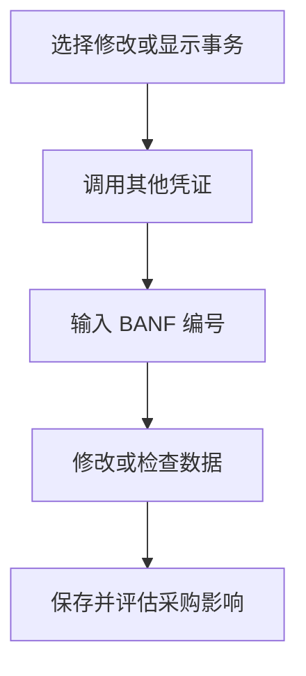

# 修改与显示采购申请 BANF

> **用途：** 修改已有 BANF，或以只读方式显示采购申请。  
> **SAP Transaction Code：** `ME52N`, `ME53N`  
> **来源：** `Banf (Standard) anlegen, ändern & anzeigen.docx`  
> **状态：** 历史培训资料整理；字段、布局、权限和 Customizing 必须在当前 SAP 系统验证。

## 1. 适用范围与前置条件

- 适用于 ZIEGLER 采购、物料需求计划或采购报表场景。
- 执行前确认公司代码、工厂、采购组织、采购组、物料和权限。
- 涉及数量、交期、供应商分配、MRP 参数或采购统计时，应进行业务负责人复核。

## 2. 流程图

## 3. SAP 页面与字段

| SAP 页面/区域 | 字段或控件 | 填写/选择 | 说明与风险 |
|---|---|---|---|
| ME52N/ME53N | Anderer Beleg | 选择 | 打开目标 BANF |
| Belegauswahl | BANF-Nummer | 采购申请号 | 确认没有选错凭证 |
| Position | Menge | 新数量 | 增加可能重新产生开放需求 |
| Position | Lieferdatum | 新交期 | 会影响采购员计划 |

## 4. 详细操作

1. **修改**  
   输入 `ME52N`，点击“其他凭证”图标，填写 BANF 编号并调用。
2. **编辑**  
   修改数量、交期或其他允许字段并保存。未生成订单时，变化会同步给采购员。
3. **已生成订单后的增加**  
   若增加数量，新增部分可能重新显示为开放需求，采购员需继续处理。
4. **已生成订单后的减少**  
   系统不会自动通知采购员已存在订单需要减少，必须主动通知采购员检查/修改订单。
5. **显示**  
   用 `ME53N` 以只读方式调用；确需修改时按权限切换至编辑模式。

## 5. 完成检查

- [ ] 输入对象、组织范围和日期范围正确
- [ ] 必填字段完整
- [ ] SAP 状态栏显示保存或执行成功
- [ ] 结果与源凭证/主数据交叉核对
- [ ] 影响采购员、MRP 或报表的变更已通知相关人员

## 6. 待确认与资料限制

- ⚠️ 减少 BANF 数量时必须主动通知采购员，避免采购订单仍按旧数量执行。

## 7. 常见风险

- 不要把“显示结果”当作“数据正确”，必须检查选择条件、单位、币种、日期和组织层级。
- 主数据或需求数量变更可能重新打开采购需求，或与已存在的采购订单脱节。
- MRP 区域、特殊采购类型和安全库存会直接影响系统采购建议，应在测试材料上验证后推广。
