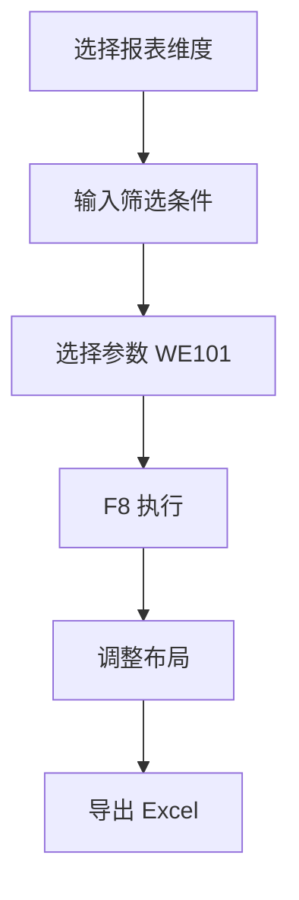

# 采购清单报表与开放订单分析

> **用途：** 按供应商、物料或 Submission 调用采购信息记录、订单、合同和询价清单。  
> **SAP Transaction Code：** `ME1M`, `ME2L`, `ME3L`, `ME4S`  
> **来源：** `Auswertungen und Reporting.docx`  
> **状态：** 历史培训资料整理；字段、布局、权限和 Customizing 必须在当前 SAP 系统验证。

## 1. 适用范围与前置条件

- 适用于 ZIEGLER 采购、物料需求计划或采购报表场景。
- 执行前确认公司代码、工厂、采购组织、采购组、物料和权限。
- 涉及数量、交期、供应商分配、MRP 参数或采购统计时，应进行业务负责人复核。

## 2. 流程图

## 3. SAP 页面与字段

| SAP 页面/区域 | 字段或控件 | 填写/选择 | 说明与风险 |
|---|---|---|---|
| ME*x* | x | 1 Infosatz / 2 Bestellung / 3 Kontrakt / 4 Anfrage | 事务族 |
| ME*x*y* | y | L Lieferant / M Material / S Submission | 选择分析维度 |
| ME2L | Lieferant | 单个/范围/空白 | 空白可能返回全部供应商 |
| ME2L | Selektionsparameter | WE101 | 开放收货，即未收货订单 |
| Ergebnisliste | Ausführen | F8 | 运行报表 |
| Liste > Exportieren | Tabellenkalkulation | 选择 | 导出 Excel |

## 4. 详细操作

1. **选择事务**  
   例如 `ME1M` 查看某材料的全部 Infosätze，`ME2L` 查看供应商订单，`ME4S` 按 Submission 查询价。
2. **筛选**  
   填写供应商、材料、工厂、采购组织、采购组和日期等必要范围。
3. **开放订单**  
   在 `ME2L` 的 Selektionsparameter 选择 `WE101`，用于筛选开放收货。
4. **执行**  
   按 F8。不要因选项列表中的历史重复名称误判结果，需按实际返回数据核对。
5. **布局与导出**  
   调整 ALV 布局；通过 Menü > Liste > Exportieren > Tabellenkalkulation 导出 Excel。

## 5. 完成检查

- [ ] 输入对象、组织范围和日期范围正确
- [ ] 必填字段完整
- [ ] SAP 状态栏显示保存或执行成功
- [ ] 结果与源凭证/主数据交叉核对
- [ ] 影响采购员、MRP 或报表的变更已通知相关人员

## 6. 待确认与资料限制

- ⚠️ 原资料指出 WE101 和 WE103 都可能显示“offener Wareneingang”，属于历史重复，当前系统含义需测试确认。

## 7. 常见风险

- 不要把“显示结果”当作“数据正确”，必须检查选择条件、单位、币种、日期和组织层级。
- 主数据或需求数量变更可能重新打开采购需求，或与已存在的采购订单脱节。
- MRP 区域、特殊采购类型和安全库存会直接影响系统采购建议，应在测试材料上验证后推广。
