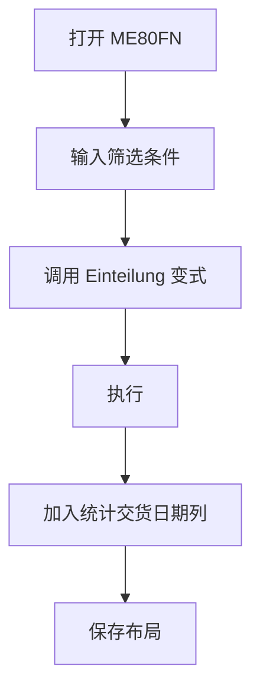

# ME80FN 期望交期与实际交期对比

> **用途：** 比较采购订单期望交期、实际交货日期和统计交货日期。  
> **SAP Transaction Code：** `ME80FN`  
> **来源：** `Auswertungen und Reporting.docx`  
> **状态：** 历史培训资料整理；字段、布局、权限和 Customizing 必须在当前 SAP 系统验证。

## 1. 适用范围与前置条件

- 适用于 ZIEGLER 采购、物料需求计划或采购报表场景。
- 执行前确认公司代码、工厂、采购组织、采购组、物料和权限。
- 涉及数量、交期、供应商分配、MRP 参数或采购统计时，应进行业务负责人复核。

## 2. 流程图

## 3. SAP 页面与字段

| SAP 页面/区域 | 字段或控件 | 填写/选择 | 说明与风险 |
|---|---|---|---|
| ME80FN Auswahl | 采购组织/供应商/物料/日期 | 按分析范围 | 范围过大会影响性能 |
| Variante | Einteilung | 选择 | 历史资料中的布局变式 |
| Layout ändern | Stat.Lieferdatum | 加入显示列 | 与 Lieferdatum 对比 |
| Ergebnis | Lieferdatum / Stat.Lieferdatum | 比较 | 需明确实际日期字段口径 |

## 4. 详细操作

1. **启动**  
   输入 `ME80FN` 并设置采购组织、供应商、物料和日期等范围。
2. **变式**  
   通过变式按钮调用 `Einteilung`。
3. **执行**  
   运行报表。
4. **调整列**  
   在 Layout ändern 中加入 `Stat.Lieferdatum`，保留 Lieferdatum、已交数量和订单信息。
5. **保存布局**  
   将验证后的布局另存为个人或授权的公共布局。
6. **解释**  
   对比期望日期和统计交货日期前，确认字段是否代表订单交期、统计交期或真实收货日期。

## 5. 完成检查

- [ ] 输入对象、组织范围和日期范围正确
- [ ] 必填字段完整
- [ ] SAP 状态栏显示保存或执行成功
- [ ] 结果与源凭证/主数据交叉核对
- [ ] 影响采购员、MRP 或报表的变更已通知相关人员

## 6. 待确认与资料限制

- ⚠️ 原资料将 Stat.Lieferdatum 描述为“实际交货日期”；业务分析前必须与 EKBE/MIGO 收货日期口径核对。

## 7. 常见风险

- 不要把“显示结果”当作“数据正确”，必须检查选择条件、单位、币种、日期和组织层级。
- 主数据或需求数量变更可能重新打开采购需求，或与已存在的采购订单脱节。
- MRP 区域、特殊采购类型和安全库存会直接影响系统采购建议，应在测试材料上验证后推广。
