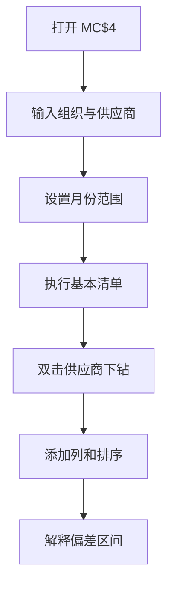

# 供应商采购金额分析和偏差区间

> **用途：** 按供应商和期间分析订购金额、收货金额、发票金额、数量偏差和交期偏差。  
> **SAP Transaction Code：** `MC$4`  
> **来源：** `Auswertungen und Reporting.docx`  
> **状态：** 历史培训资料整理；字段、布局、权限和 Customizing 必须在当前 SAP 系统验证。

## 1. 适用范围与前置条件

- 适用于 ZIEGLER 采购、物料需求计划或采购报表场景。
- 执行前确认公司代码、工厂、采购组织、采购组、物料和权限。
- 涉及数量、交期、供应商分配、MRP 参数或采购统计时，应进行业务负责人复核。

## 2. 流程图

## 3. SAP 页面与字段

| SAP 页面/区域 | 字段或控件 | 填写/选择 | 说明与风险 |
|---|---|---|---|
| MC$4 Auswahl | Einkaufsorganisation | 例如 1000 | 按组织分析 |
| MC$4 Auswahl | Lieferant | 单个或范围 | 可按供应商筛选 |
| Analysezeitraum | Monat von/bis | 分析月份 | 统一期间口径 |
| Grundliste | Bestellwert / Wareneingangswert / Rechnungsbetrag | 查看 | 金额含义不同 |
| Aufriss | Mengenabw.1-5 | Customizing 区间 | 最多五个数量偏差区间 |
| Benutzereinstellungen | Anzeigeoptionen | 个人设置 | 每个事务需单独保存 |

## 4. 详细操作

1. **选择**  
   输入 `MC$4`，填写采购组织、供应商和月份区间。
2. **执行**  
   运行 Lieferantenanalyse Einkaufswerte。
3. **下钻**  
   在 Grundliste 双击供应商，进入材料或其他分析层级。
4. **扩充视图**  
   添加 Bestellmenge、Bestellpreis、Mengenabw.1-5 等列并设置排序。
5. **解释金额**  
   Bestellwert、Wareneingangswert 和 Rechnungsbetrag不可直接等同，因收货和开票可能跨期。
6. **解释偏差**  
   数量与交期偏差的五个区间由 Customizing 定义，例如 -20% 以下、-19% 至 -10%、-9% 至 10%、11% 至 20%、21% 以上。
7. **保存**  
   在 Benutzereinstellungen 保存个人显示设置；每个事务分别配置。

## 5. 完成检查

- [ ] 输入对象、组织范围和日期范围正确
- [ ] 必填字段完整
- [ ] SAP 状态栏显示保存或执行成功
- [ ] 结果与源凭证/主数据交叉核对
- [ ] 影响采购员、MRP 或报表的变更已通知相关人员

## 6. 待确认与资料限制

- ⚠️ 偏差区间取自 Customizing，不应把培训示例当作当前固定阈值。
- ⚠️ 交期正负号的业务表达必须按公司统一规则解释；ZIEGLER 分析中早到为正、晚到为负。

## 7. 常见风险

- 不要把“显示结果”当作“数据正确”，必须检查选择条件、单位、币种、日期和组织层级。
- 主数据或需求数量变更可能重新打开采购需求，或与已存在的采购订单脱节。
- MRP 区域、特殊采购类型和安全库存会直接影响系统采购建议，应在测试材料上验证后推广。
