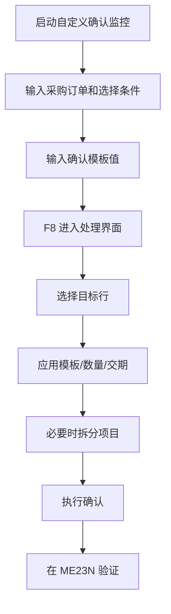

# 采购订单确认监控 Bestellbestätigungsmonitor

> **用途：** 录入供应商订单确认号、确认日期、确认数量和交期，并验证订单项目中的 Bestätigungen。  
> **SAP Transaction Code：** `/JA41/_BC_IMG`, `/JA41/_BBEST`, `ME23N`  
> **来源：** `Bestellbestätigungsmonitor FERTIG.docx`  
> **状态：** 根据历史培训资料更新。字段、权限、放行策略和自定义事务必须在当前 SAP 系统验证。

## 1. 适用范围与角色

- 适用于 ZIEGLER 采购申请、采购订单确认和采购监控。
- 角色包括需求申请人、审批人、采购员和负责 Disponent。
- 涉及成本对象、交期确认、统计相关交期和订单数量时，必须核对原始凭证并保留四眼原则。

## 2. 流程图

## 3. SAP 页面与字段

| SAP 页面/区域 | 字段或控件 | 填写/选择 | 说明与风险 |
|---|---|---|---|
| Selektionsmaske | Einkaufsbeleg | 4500 开头采购订单号 | 录入新 AB 时必填 |
| Selektionsmaske | Nur Pos. mit offener WE-Menge | 按需要勾选 | 原资料描述与字段文本存在潜在矛盾，需当前系统测试 |
| Selektionsmaske | nur bereits bestätigte Positionen selektieren und ändern | 改期时勾选 | 用于已有确认的后续 Terminverschiebung |
| Ablauf Steuerung | Direkt Verarbeitungsmaske | 选择 | 直接进入处理屏幕 |
| Vorschlagswerte | Auftragsbestätigung | 供应商 AB 号 | 将复制到选中行 |
| Vorschlagswerte | Bestätigungssteuerung | Z001 | 历史示例值 |
| Vorschlagswerte | Bestätigungstyp | AB 或改期类型 | 首次确认通常 AB |
| Vorschlagswerte | Typ des Bestätigungsdatums | T | 历史示例值 |
| Vorschlagswerte | Bestätigungsdatum Vorschlag | 供应商确认交期 | 非必填；可批量传到选中项目 |
| Vorschlagswerte | Erstellungsdatum | 录入日期 | 默认当天 |
| Vorschlagswerte | Statistikrelevantes Lieferdatum überschreiben | 按责任判断 | 首次 AB 或非供应商责任改期时才考虑 |
| Verarbeitungsmaske | Übernahme Vorschläge | 点击 | 复制 AB 号、创建日期及可选确认日期 |
| Verarbeitungsmaske | Übern. Einteil.Menge | 点击 | 复制订单计划数量 |
| Verarbeitungsmaske | Übern. LfDat. aus Einteilung | 点击 | 供应商确认原期望交期时复制 |
| Verarbeitungsmaske | Bestätigung ausführen | 点击 | 保存选中行确认 |
| ME23N > Position | Bestätigungen | 检查 | 确认类型、交期、数量和 AB 号 |

## 4. 详细操作

1. **启动**  
   通过 SAP 树或收藏夹打开 Bestellbestätigungsmonitor。资料显示菜单节点为 `/JA41/_BBEST`，上级自定义节点为 `/JA41/_BC_IMG`。
2. **选择订单**  
   输入 Einkaufsbeleg；按场景设置开放收货数量和仅修改已确认项目的复选框。
3. **模板值**  
   输入 Auftragsbestätigung、Bestätigungssteuerung、Bestätigungstyp、创建日期及可选确认交期。
4. **统计交期**  
   仅当首次 AB，或本次改期不应归责供应商时，才考虑覆盖 statistikrelevantes Lieferdatum。该字段影响供应商评价。
5. **执行**  
   选择 Direkt Verarbeitungsmaske，按 F8。
6. **选行**  
   只标记需要处理的行。点击 Übernahme Vorschläge、Übern. Einteil.Menge 或 Übern. LfDat. aus Einteilung；偏差项手工修正。
7. **拆分交付**  
   供应商分批交货时，先把原行确认数量改为第一批数量，选中后点击 Position splitten；在新增行填剩余数量和第二个交期。
8. **保存确认**  
   选中所有应处理行，点击 Bestätigung ausführen。确认成功后行尾显示绿色状态。
9. **复核订单**  
   用 `ME23N` 打开订单，在项目页签 Bestätigungen 检查 AB 号、确认数量和交期。

## 5. 完成检查

- [ ] 采购订单号正确
- [ ] 只选择了应处理的位置
- [ ] AB 号和创建日期正确
- [ ] 确认类型符合首次确认或改期场景
- [ ] 确认数量合计等于供应商确认数量
- [ ] 统计相关交期覆盖决定有依据
- [ ] 绿色成功状态出现
- [ ] ME23N 中 Bestätigungen 已核对

## 6. 待确认与资料限制

- ⚠️ 自定义事务名称在资料中显示为菜单节点 `/JA41/_BBEST`，需确认当前可直接输入的实际事务代码。
- ⚠️ “Nur Pos. mit offener WE-Menge”按字段字面通常表示仅选择仍有开放收货量的项目，但原文称可排除部分交付项目；两者可能不一致，必须实机验证。

## 7. 错误处理和风险

- 只有 SAP 状态栏出现成功消息、生成 BANF 号或确认行出现绿色状态时，才视为完成。
- 批量处理前必须检查已选中的行。模板值只应应用到实际需要修改的行项目。
- 交期、数量或成本对象错误会影响采购、预算和供应商评价，不应仅依赖系统默认值。
