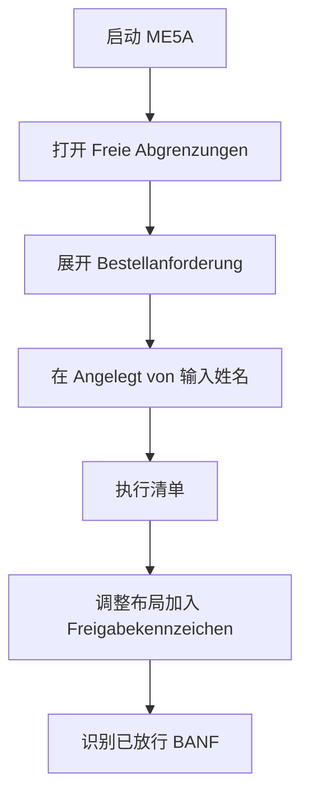

# 按创建人查看 BANF 与放行状态

> **用途：** 按 Sachbearbeiter/创建人筛选采购申请，并在结果中显示 Freigabekennzeichen。  
> **SAP Transaction Code：** `ME5A`  
> **来源：** `Banfen pro Sachbearbeiter anzeigen.docx`  
> **状态：** 根据历史培训资料更新。字段、权限、放行策略和自定义事务必须在当前 SAP 系统验证。

## 1. 适用范围与角色

- 适用于 ZIEGLER 采购申请、采购订单确认和采购监控。
- 角色包括需求申请人、审批人、采购员和负责 Disponent。
- 涉及成本对象、交期确认、统计相关交期和订单数量时，必须核对原始凭证并保留四眼原则。

## 2. 流程图

## 3. SAP 页面与字段

| SAP 页面/区域 | 字段或控件 | 填写/选择 | 说明与风险 |
|---|---|---|---|
| ME5A Selektionsbild | Freie Abgrenzungen | 点击 | 打开动态选择 |
| Freie Abgrenzungen > Bestellanforderung | Angelegt von | 姓名或用户搜索条件 | 历史示例使用 *schwenk* |
| Ergebnisliste | Layout anpassen | 点击 | 打开列选择 |
| Spaltenvorrat | Freigabekennz | 加入显示列 | 结果中显示为 Frg |
| Ergebnisliste | Frg | 绿色勾选 | 表示 BANF 已放行 |

## 4. 详细操作

1. **进入事务**  
   输入 `ME5A`。
2. **动态选择**  
   点击 Freie Abgrenzungen，双击 Bestellanforderung 旁的箭头展开字段。
3. **创建人**  
   在 `Angelegt von` 输入目标 Sachbearbeiter 的用户名或搜索模式。必要时增加工厂、采购组、日期和删除标识筛选。
4. **执行**  
   点击 Ausführen。
5. **布局**  
   点击 Layout anpassen，从列库将 `Freigabekennz` 加入显示列并确认。
6. **解释结果**  
   结果列 `Frg` 出现绿色勾选表示 BANF 已放行；无勾选不一定等于被拒绝，也可能仍在审批或不适用。
7. **保存布局**  
   如权限允许，将布局保存为个人变式，避免每次重新添加。

## 5. 完成检查

- [ ] Angelegt von 对应正确 SAP 用户
- [ ] 日期和组织筛选合理
- [ ] Freigabekennz 已加入
- [ ] 未把未放行误判为拒绝
- [ ] 结果已按 BANF 号抽样验证

## 6. 待确认与资料限制

- ⚠️ 人员姓名与 SAP Benutzer 可能不同，应优先使用当前系统中的 Benutzername 或搜索帮助。

## 7. 错误处理和风险

- 只有 SAP 状态栏出现成功消息、生成 BANF 号或确认行出现绿色状态时，才视为完成。
- 批量处理前必须检查已选中的行。模板值只应应用到实际需要修改的行项目。
- 交期、数量或成本对象错误会影响采购、预算和供应商评价，不应仅依赖系统默认值。
