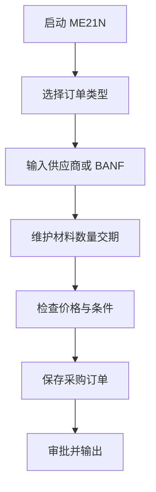

# 使用 ME21N 手工创建采购订单

> **用途：** 无 BANF、引用 BANF 或引用框架协议创建采购订单，并控制价格、审批和输出。  
> **SAP Transaction Code：** `ME21N`, `ME22N`, `ME23N`  
> **来源：** `Bestellung (inkl. Sonder-) anlegen me21n FERTIG.docx`  
> **状态：** 历史培训资料整理，当前字段、订单类型、编号范围、审批和输出管理须实机验证。

## 1. 适用范围与权限

- 适用于采购订单、BANF 转订单、特殊订单和委外供料。
- 执行人应具备对应采购组织、工厂、订单类型和输出权限。
- 价格、预付款、跨公司订单、库存过账和供应商输出必须遵循四眼原则。

## 2. 流程图

## 3. SAP 页面与字段

| SAP 页面/区域 | 字段或控件 | 填写/选择 | 说明与风险 |
|---|---|---|---|
| ME21N Kopf | Bestellart | Normalbestellung 或批准的特殊类型 | 左上角选择 |
| Kopf | Lieferant | 供应商号 | 有 BANF 固定供应源时可自动带出 |
| Position | Material | 材料号 | 与供应商有 Infosatz 时自动定价 |
| Position | Bestellmenge | 订单数量 | 复核单位 |
| Position | Lieferdatum | 要求交期 | 系统可从主数据建议 |
| Position | Banf / Banf-Position | BANF 号/项目 | 引用已有需求 |
| Position | Rahmenvertrag | 合同号/项目 | 引用框架合同 |
| Konditionssteuerung | Schätzpreis | 按审批场景勾选 | 估价需后续替换为正式价格 |
| Konditionssteuerung | Preisdruck | 取消以隐藏估价 | 避免向供应商打印估算价格 |
| Position > Rechnung | Anzahlungstyp / Betrag oder Prozent / Fälligkeit | 在项目层维护 | 抬头层预付款禁止 |
| Toolbar | Merken / Vorerfassen | 临时保存 | 正式 Speichern 会启动审批 |

## 4. 详细操作

1. **启动**  
   输入 `ME21N`，在左上角选择 Normalbestellung 或获批的特殊 Bestellart。
2. **无 BANF 创建**  
   填写 Lieferant、Material 和 Bestellmenge；复核 SAP 从 Infosatz、主数据带出的价格与 Lieferzeit。
3. **引用 BANF**  
   在项目中输入 BANF 号；Material、数量和日期自动复制。Orderbuch 固定供应源存在时，Lieferant 也可自动带出。
4. **引用合同**  
   在 Rahmenvertrag 字段填写框架协议及项目，检查剩余数量和有效期。
5. **复核**  
   检查净价、币种、价格单位、税码、Incoterms、付款条件、交期、账户分配和文本。
6. **估价紧急订单**  
   在 Konditionssteuerung 标记 Schätzpreis；若不应向供应商展示估价，取消 Preisdruck。
7. **预付款**  
   只在项目页签 Rechnung 维护 Anzahlungstyp、金额/比例和到期日。禁止在抬头层创建。
8. **临时保存**  
   仍需编辑时使用 Merken/Vorerfassen；经 `ME22N` 继续处理。
9. **正式保存**  
   点击 Speichern，记录采购订单号。正式保存触发审批和最终输出流程。

## 5. 完成检查

- [ ] 供应商、采购组织、工厂和采购组正确
- [ ] 材料、数量、单位、交期和价格正确
- [ ] BANF、合同或供应源引用正确
- [ ] 审批、输出和后续交付步骤明确
- [ ] 状态栏返回采购订单号或成功状态

## 6. 待确认与资料限制

- ⚠️ 历史资料将 Merken 与 Vorerfassen 视为无实质差异，当前系统状态、权限与后续处理仍需确认。
- ⚠️ 正式订单输出可能已从历史 DOM 迁移至当前 Output Management。

## 7. 风险

- 不得通过手工改单绕过 Freigabestrategie、价格授权或 Intercompany 流程。
- 同一供应商的多个 BANF 应尽量合并，避免重复订单和额外运费。
- 预付款只能按当前财务规则维护，历史资料明确禁止在抬头层维护。
