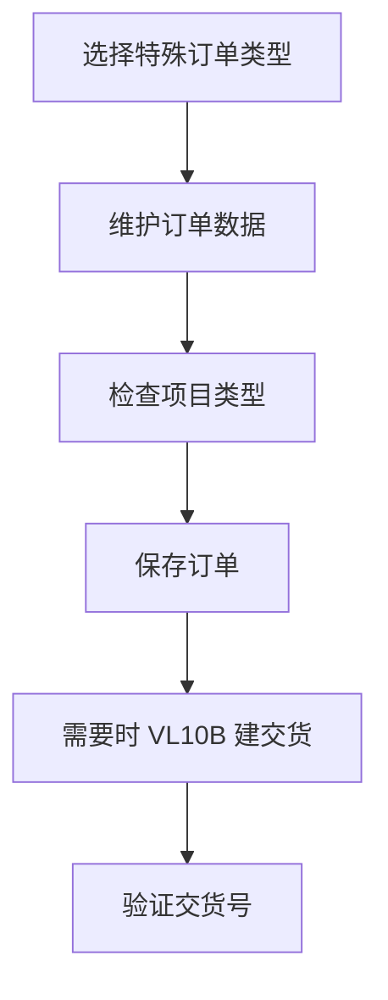

# 创建特殊采购订单与交货

> **用途：** 创建退货订单、计划协议/框架订单、带交货的库存调拨订单，并区分 Intercompany 场景。  
> **SAP Transaction Code：** `ME21N`, `VL10B`  
> **来源：** `Bestellung (inkl. Sonder-) anlegen me21n FERTIG.docx`  
> **状态：** 历史培训资料整理，当前字段、订单类型、编号范围、审批和输出管理须实机验证。

## 1. 适用范围与权限

- 适用于采购订单、BANF 转订单、特殊订单和委外供料。
- 执行人应具备对应采购组织、工厂、订单类型和输出权限。
- 价格、预付款、跨公司订单、库存过账和供应商输出必须遵循四眼原则。

## 2. 流程图

## 3. SAP 页面与字段

| SAP 页面/区域 | 字段或控件 | 填写/选择 | 说明与风险 |
|---|---|---|---|
| ME21N | Bestellart | Retourenbestellung / Rahmenbestellung / Umlag.Best.Lief | 按场景选择 |
| Retourenposition | Retourenposition | 勾选 | 退回供应商 |
| Lieferplan | Einteilungen | 维护数量与日期 | 定义分批调用 |
| Umlagerung Kopf | Lieferwerk | ZIEGLER 内部工厂 | 替代 Lieferant |
| Umlagerung Position | Positionstyp | U | 带交货库存调拨 |
| VL10B | Bestellung | 6500…订单号 | 选择待交货订单 |
| VL10B | Lieferung im Hintergrund | 执行 | 生成 80…交货号 |

## 4. 详细操作

1. **退货订单**  
   在 `ME21N` 选择 Retourenbestellung；维护供应商、材料、数量和退货项目标识。完整退货流程以供应商退货文档为准。
2. **计划交付**  
   选择 Rahmenbestellung/适用类型，在项目页签 Einteilungen 维护各期数量和交付日期。
3. **库存调拨**  
   选择 Umlag.Best.Lief；SAP 抬头从 Lieferant 切换为 Lieferwerk，只能选择集团内部供货工厂，项目类型为 `U`。
4. **组织检查**  
   带交货库存调拨只适用于相同采购组织且不向集团内部供应商计价的场景。
5. **Intercompany 判断**  
   采购组织不同或需要集团内部结算时，不用该简化流程，应通过 EDI Intercompany-Bestellung。
6. **创建交货**  
   保存 6500…调拨订单后运行 `VL10B`，可清空选择屏幕并筛选订单。标记行，点击 Lieferung im Hintergrund，再点击两个卡车图标创建交货。
7. **验证**  
   记录 80…交货号，并检查供货工厂、收货工厂、数量和日期。

## 5. 完成检查

- [ ] 供应商、采购组织、工厂和采购组正确
- [ ] 材料、数量、单位、交期和价格正确
- [ ] BANF、合同或供应源引用正确
- [ ] 审批、输出和后续交付步骤明确
- [ ] 状态栏返回采购订单号或成功状态

## 6. 待确认与资料限制

- ⚠️ 6500…采购订单和 80…交货号码范围是历史配置，当前系统需验证。
- ⚠️ 框架订单与真正 Scheduling Agreement 的业务对象可能不同，必须按当前 Bestellart 确认。

## 7. 风险

- 不得通过手工改单绕过 Freigabestrategie、价格授权或 Intercompany 流程。
- 同一供应商的多个 BANF 应尽量合并，避免重复订单和额外运费。
- 预付款只能按当前财务规则维护，历史资料明确禁止在抬头层维护。
