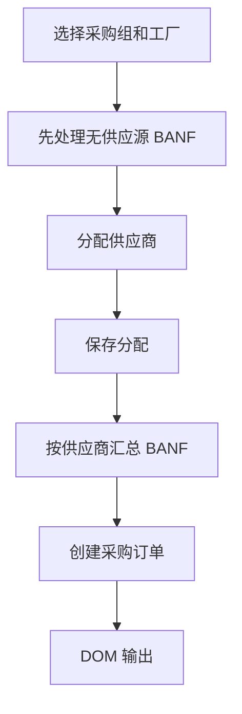

# 使用 ME57 分配 BANF 并创建采购订单

> **用途：** 按采购组处理 BANF、分配供应源、合并同一供应商需求并生成采购订单。  
> **SAP Transaction Code：** `ME57`  
> **来源：** `Bestellung anlegen me57 FERTIG.docx`  
> **状态：** 历史培训资料整理，当前字段、订单类型、编号范围、审批和输出管理须实机验证。

## 1. 适用范围与权限

- 适用于采购订单、BANF 转订单、特殊订单和委外供料。
- 执行人应具备对应采购组织、工厂、订单类型和输出权限。
- 价格、预付款、跨公司订单、库存过账和供应商输出必须遵循四眼原则。

## 2. 流程图

## 3. SAP 页面与字段

| SAP 页面/区域 | 字段或控件 | 填写/选择 | 说明与风险 |
|---|---|---|---|
| ME57 Auswahl | Einkäufergruppe | 例如 F08 | 本人或代理采购组 |
| ME57 Auswahl | Werk | 1000 | Giengen 历史示例 |
| ME57 Auswahl | Listumfang | ALV | 列表输出 |
| ME57 Auswahl | Zugeordnete Banfen | 先取消后勾选 | 先处理无供应源，再处理已分配需求 |
| ME57 Auswahl | Nur freigegebene Banfen | 勾选 | 只处理已审批需求 |
| Positionsübersicht | Fst.Lief | 固定供应商 | 来源于 Orderbuch |
| Positionsdetail > Bezugsquelle | Infosatz / Wunschlieferant | 选择 | 无 Infosatz/Orderbuch 无法分配 |
| Zuordnungen | Bestellung anlegen | 点击 | 将供应商 BANF 转订单 |
| ME21N Warenkorb | BANF-Positionen | 拖入/自动带入 | 按系统变式 |
| DOM | Dokumentauswahl / Empfänger | 选择 | 审批完成后发送 |

## 4. 详细操作

1. **选择**  
   输入 `ME57`，填写 Einkaufsgruppe、Werk 1000 和 Listumfang ALV；勾选需要的汇总、放行和分配状态。
2. **先处理无供应源**  
   初次取消 `Zugeordnete Banfen`，只显示无供应源需求，避免后续为同一供应商拆成多张订单。
3. **查看区域**  
   Zuordnungen 按供应商汇总，Positionsübersicht 显示全部 BANF，Positionsdetail 显示当前需求的 Bezugsquelle 等详情。
4. **分配供应源**  
   标记 BANF，点击 Position bearbeiten 或 Bezugsquelle zuordnen；从可用 Infosatz 列表选择 Wunschlieferant，再点击 Zugeordnete Bezugsquelle。
5. **保存分配**  
   保存后应出现绿色完成标识和供应源图标。无 Infosatz 与 Orderbuch 时，先创建 Infosatz，再维护 Orderbuch。
6. **生成订单**  
   重新包含已分配 BANF，在 Zuordnungen 标记供应商并点击 Bestellung anlegen。
7. **购物车**  
   按当前变式，BANF 可能自动进入订单，也可能需单独或批量拖入 Warenkorb。检查价格、数量、交期和文本。
8. **保存**  
   保存生成 4500…采购订单；返回 ME57 后记录状态栏订单号。已覆盖数量的 BANF 不能再次下单。
9. **输出**  
   DOM 中逐项选择需随订单发送的文档，进入邮件编辑，检查正文和额外收件人。最后审批完成后系统才自动发送。

## 5. 完成检查

- [ ] 供应商、采购组织、工厂和采购组正确
- [ ] 材料、数量、单位、交期和价格正确
- [ ] BANF、合同或供应源引用正确
- [ ] 审批、输出和后续交付步骤明确
- [ ] 状态栏返回采购订单号或成功状态

## 6. 待确认与资料限制

- ⚠️ 采购组 F08 和 Werk 1000 为历史示例，应按采购员职责使用。
- ⚠️ DOM 屏幕、邮件发送和审批触发规则需按当前系统验证。

## 7. 风险

- 不得通过手工改单绕过 Freigabestrategie、价格授权或 Intercompany 流程。
- 同一供应商的多个 BANF 应尽量合并，避免重复订单和额外运费。
- 预付款只能按当前财务规则维护，历史资料明确禁止在抬头层维护。
