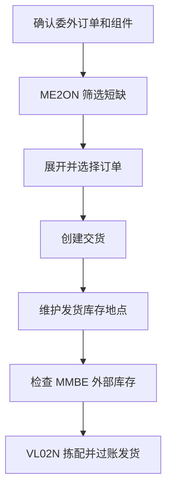

# 委外加工供料与外部库存检查

> **用途：** 对项目类型 L 的委外加工订单创建供料交货，并检查供应商外部库存。  
> **SAP Transaction Code：** `ME2ON`, `MMBE`, `VL02N`  
> **来源：** `Bestellung mit Beistellung Lieferung anlegen FERTIG.docx`  
> **状态：** 历史培训资料整理，当前字段、订单类型、编号范围、审批和输出管理须实机验证。

## 1. 适用范围与权限

- 适用于采购订单、BANF 转订单、特殊订单和委外供料。
- 执行人应具备对应采购组织、工厂、订单类型和输出权限。
- 价格、预付款、跨公司订单、库存过账和供应商输出必须遵循四眼原则。

## 2. 流程图

## 3. SAP 页面与字段

| SAP 页面/区域 | 字段或控件 | 填写/选择 | 说明与风险 |
|---|---|---|---|
| 采购订单/BANF | Positionstyp | L | 由 Infosatz 决定的 Lohnbearbeitung 项目 |
| ME2ON Auswahl | Werk | 1000 示例 | 实际供料工厂 |
| ME2ON Auswahl | Mit ext. Zugängen aus Best. | 保留勾选 | 历史流程要求 |
| ME2ON Auswahl | Nur LB-Best. mit Unterdeckung | 勾选 | 仅显示组件短缺 |
| ME2ON Ergebnis | LKW / Lieferung anlegen | 点击 | 为选中订单创建交货 |
| Lieferung | Lagerort | 手工输入 | 从该库存地点扣减 |
| MMBE | Material | 供料组件 | 查看 Lieferantenbestand |
| VL02N > Kommissionierung | Kommissioniermenge | 发运数量 | 完成拣配 |
| VL02N | Warenausgang buchen | 点击 | 完成发货 |

## 4. 详细操作

1. **识别订单**  
   正常创建委外采购订单；项目类型 `L` 表明 Beistellung/Lohnbearbeitung，组件来自委外 BOM/订单。
2. **启动 Cockpit**  
   输入 `ME2ON`。按需限制供应商、组件、Baugruppe、Werk 和 Bedarfsdatum。保留 Mit ext. Zugängen aus Best.，勾选 Nur LB-Best. mit Unterdeckung。
3. **选择需求**  
   F8 执行，用双箭头展开所有位置。红点通常表示尚缺供料组件。
4. **创建交货**  
   标记相关订单行并点击卡车图标 Lieferung anlegen。
5. **维护库存地点**  
   填写实际扣料 Lagerort，此字段必须手工输入。库存不足时先采购或从外仓调拨。
6. **生成凭证**  
   维护必填数据后点击 Beleg anlegen，记录交货号。
7. **库存验证**  
   用 `MMBE` 输入供料组件，检查 Lieferantenbestand；双击查看具体供应商和数量。
8. **发运过账**  
   运输人员用 `VL02N` 打开交货，在 Kommissionierung 输入数量，再执行 Warenausgang buchen。
9. **不同场景**  
   材料号不变的外部加工，例如外协镀锌，历史资料以 Kontierung `F` 表示，并由生产按生产订单手工发运和监控，不与 L 项目混用。

## 5. 完成检查

- [ ] 供应商、采购组织、工厂和采购组正确
- [ ] 材料、数量、单位、交期和价格正确
- [ ] BANF、合同或供应源引用正确
- [ ] 审批、输出和后续交付步骤明确
- [ ] 状态栏返回采购订单号或成功状态

## 6. 待确认与资料限制

- ⚠️ ME2ON 选择框的具体含义与默认值需在当前系统实机确认。
- ⚠️ Kontierung F 的外部加工处理属于生产流程，当前用法应与 PP/生产团队确认。

## 7. 风险

- 不得通过手工改单绕过 Freigabestrategie、价格授权或 Intercompany 流程。
- 同一供应商的多个 BANF 应尽量合并，避免重复订单和额外运费。
- 预付款只能按当前财务规则维护，历史资料明确禁止在抬头层维护。
