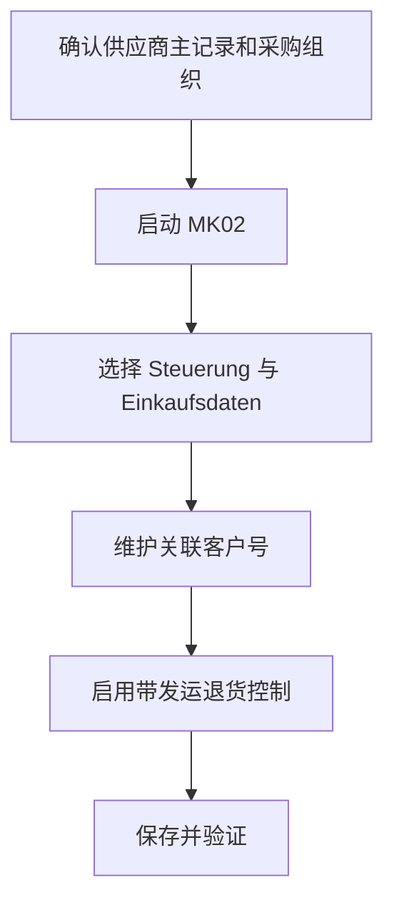

# 维护委外供料供应商主数据

> **用途：** 为委外供料和带发运处理的供应商维护客户关联及采购控制数据。  
> **Transaction Code：** `MK02`  
> **来源文件：** `Bestellung mit Beistellung Stammdatenpflege FERTIG.docx`  
> **状态：** 历史培训资料整理；字段、权限、组织数据与 Customizing 必须在当前系统验证。

## 1. 适用范围与权限

- 适用于采购、物料计划或工程变更相关岗位。
- 执行人必须具备对应事务、工厂、采购组织及对象的修改权限。
- 影响采购建议、BOM、委外供料、库存或供应商评价的变更，应执行四眼复核。

## 2. 流程图

## 3. 页面与字段

| 页面/区域 | 字段或控件 | 填写/选择 | 说明与风险 |
|---|---|---|---|
| Kreditor ändern: Einstieg | Kreditor | 供应商号 | 示例号不得直接复制 |
| Kreditor ändern: Einstieg | Einkaufsorganisation | 实际采购组织 | 历史资料示例为 1000 |
| Allgemeine Daten | Steuerung | 勾选 | 进入控制数据 |
| Einkaufsorganisationsdaten | Einkaufsdaten | 勾选 | 进入采购组织数据 |
| Steuerung | Debitor | 关联客户号 | 没有客户号将无法执行发运 |
| Einkaufsdaten > Steuerungsdaten | Ret. mit Versandabw. | 勾选 | 启用退货/供料的发运处理 |

## 4. 详细操作

1. **准备**  
   检查供应商是否已存在关联客户主数据；没有客户号时先按主数据流程建立。
2. **入口**  
   输入 `MK02`，填写供应商号和采购组织。勾选 Steuerung 与 Einkaufsdaten。
3. **客户关联**  
   在 Steuerung 页面确认 `Debitor` 已维护。该关联使发运处理能够把供应商作为收货方处理。
4. **采购控制**  
   切换至 Einkaufsdaten，在 Steuerungsdaten 勾选 `Ret. mit Versandabw.`。
5. **保存**  
   保存主数据变更并记录变更原因。
6. **验证**  
   用测试订单或显示模式确认客户关联和发运标识均可见。

## 5. 完成检查

- [ ] 供应商号和采购组织正确
- [ ] 关联客户号存在且有效
- [ ] Ret. mit Versandabw. 已启用
- [ ] 变更经过主数据复核
- [ ] 未修改无关的付款或税务字段

## 6. 待确认事项

- ⚠️ 供应商与客户主数据关联属于高影响设置，当前主数据治理和权限流程需确认。

## 7. 常见风险

- 系统显示结果不等于业务结果正确，必须核对对象、工厂、有效日期、数量和状态栏消息。
- 不得通过主数据或 BOM 修改绕过采购、工程变更或审批流程。
- 示例材料号、供应商号、项目号和组织值只用于理解页面，不应直接复制到实际业务。
