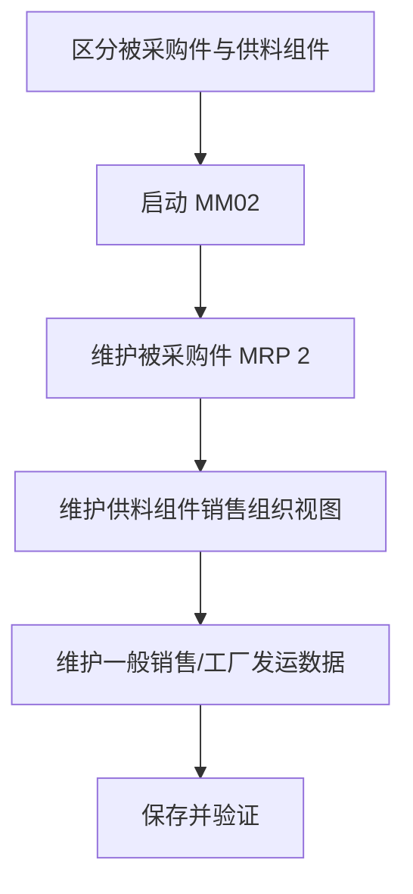

# 维护委外采购及供料组件材料主数据

> **用途：** 为委外采购件维护特殊采购类型，为供料组件扩展销售和发运视图。  
> **Transaction Code：** `MM02`  
> **来源文件：** `Bestellung mit Beistellung Stammdatenpflege FERTIG.docx`  
> **状态：** 历史培训资料整理；字段、权限、组织数据与 Customizing 必须在当前系统验证。

## 1. 适用范围与权限

- 适用于采购、物料计划或工程变更相关岗位。
- 执行人必须具备对应事务、工厂、采购组织及对象的修改权限。
- 影响采购建议、BOM、委外供料、库存或供应商评价的变更，应执行四眼复核。

## 2. 流程图

## 3. 页面与字段

| 页面/区域 | 字段或控件 | 填写/选择 | 说明与风险 |
|---|---|---|---|
| MM02 > Disposition 2 | Beschaffungsart | F | 外部采购 |
| MM02 > Disposition 2 | Sonderbeschaffung | 30 | 委外加工/Lohnbearbeitung |
| Vertrieb: VerkaufsorgDaten 1 | Auslieferungswerk | 实际发货工厂 | 历史资料示例为 1000 |
| Vertrieb: VerkaufsorgDaten 1 | Steuerklassifikation | 按税务规则 | 历史截图示例为 1 |
| Vertrieb: allg./Werk | Transportgruppe | 0001 | 历史标准值 |
| Vertrieb: allg./Werk | Ladegruppe | 0001 | 历史标准值 |

## 4. 详细操作

1. **对象区分**  
   被采购件需要委外采购参数；供料组件因为要发运给外部收货方，需要销售与发运视图。
2. **被采购件**  
   输入 `MM02` 和材料号，选择 Disposition 2。维护 Beschaffungsart `F` 和 Sonderbeschaffung `30`。
3. **供料组件销售视图**  
   为供料组件扩展 Vertrieb: VerkaufsorgDaten 1，维护 Auslieferungswerk 和税分类。
4. **供料组件发运视图**  
   在 Vertrieb: allg./Werk 中维护 Transportgruppe `0001` 和 Ladegruppe `0001`。
5. **保存**  
   保存材料主数据。
6. **验证**  
   在显示模式检查区域、工厂、销售组织和分销渠道没有选错，并通过委外订单测试组件确定。

## 5. 完成检查

- [ ] 被采购件与供料组件没有混淆
- [ ] 特殊采购 30 已在正确工厂维护
- [ ] 供料组件销售视图完整
- [ ] 发货工厂正确
- [ ] 运输组和装载组符合当前配置

## 6. 待确认事项

- ⚠️ F/30、0001 和税分类 1 均为历史配置，必须按当前工厂和销售组织确认。

## 7. 常见风险

- 系统显示结果不等于业务结果正确，必须核对对象、工厂、有效日期、数量和状态栏消息。
- 不得通过主数据或 BOM 修改绕过采购、工程变更或审批流程。
- 示例材料号、供应商号、项目号和组织值只用于理解页面，不应直接复制到实际业务。
