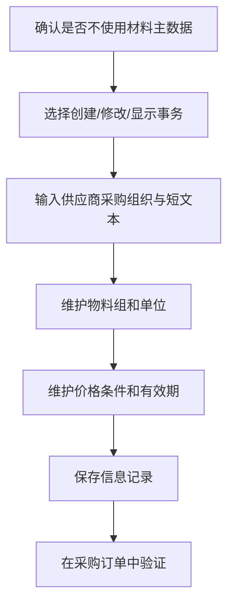

# 无材料号采购信息记录及参数化服务编码

> **用途：** 使用无材料号采购信息记录管理参数化、表面处理或服务类采购价格和供应商条件。  
> **Transaction Code：** `ME11`, `ME12`, `ME13`  
> **来源文件：** `Einkaufsinfosätze ohne Materialnummer - Parametrierung und Oberfläche.docx`  
> **状态：** 历史培训资料整理；字段、权限、状态码、自定义对象和金额阈值必须在当前系统验证。

## 1. 适用范围与权限

- 适用于采购、主数据、审批策略或输出管理相关岗位。
- 修改分类、特征、审批人、金额边界或输出规则属于高风险配置，应在开发/测试系统验证并执行四眼复核。
- 生产系统变更必须有变更单、测试证据、回退方案和审批记录。

## 2. 流程图

## 3. 页面与字段

| 页面/区域 | 字段或控件 | 填写/选择 | 说明与风险 |
|---|---|---|---|
| ME11/ME12/ME13 Einstieg | Lieferant | 供应商号 | 必须与实际供应商一致 |
| Einstieg | Einkaufsorganisation | 实际采购组织 | 组织范围 |
| Einstieg | Werk | 按当前配置 | 可能是可选或必填 |
| Einstieg | Material | 留空 | 此流程针对无材料号 Infosatz |
| Allgemeine Daten | Kurztext | 参数化/表面处理服务描述 | 应使用可搜索且标准化描述 |
| Allgemeine Daten | Warengruppe | 服务或加工物料组 | 影响报表和审批 |
| Allgemeine Daten | Bestellmengeneinheit | ST/LE/其他实际单位 | 与报价计价单位一致 |
| Einkaufsorganisationsdaten | Nettopreis / Preiseinheit | 价格与每价单位 | 例如 EUR/1 ST 或 EUR/100 ST |
| Konditionen | Gültig von/bis | 有效期 | 避免过期价格自动进入订单 |
| Zusatzdaten | Lieferzeit / Mindestmenge | 按协议 | 如适用 |

## 4. 详细操作

1. **适用判断**  
   仅当采购对象无需材料主数据、但需要重复定价和供应商条件时使用无材料号 Infosatz。
2. **事务选择**  
   创建用 `ME11`，修改用 `ME12`，显示用 `ME13`。
3. **关键入口**  
   填写供应商、采购组织和工厂；Material 保持空白。
4. **描述标准化**  
   使用统一 Kurztext，例如“参数化 + 品牌/系统”或“外协 + 表面处理类型”。避免仅写模糊词。
5. **分类与单位**  
   维护 Warengruppe、Bestellmengeneinheit、价格单位和必要排序字段。
6. **价格条件**  
   录入净价、币种、有效期、最小量和交期。
7. **保存**  
   保存并记录 Infosatz 编号。
8. **验证**  
   在测试采购订单中以短文本/物料组调用，确认供应商、价格、单位和有效期正确。

## 5. 完成检查

- [ ] 确认确实不需要材料主数据
- [ ] 供应商和采购组织正确
- [ ] 短文本标准化
- [ ] 物料组正确
- [ ] 计价单位与订购单位一致
- [ ] 价格有效期完整
- [ ] 测试订单取价正确

## 6. 待确认事项

- ⚠️ 源文件仅给出历史 Infosatz 编号与描述，未提供页面步骤；事务和字段按经典采购信息记录流程编制，必须在当前系统验证。
- ⚠️ 历史编号清单不写入流程，避免被当作当前有效主数据。

## 7. 常见风险

- 错误的分类值或边界会导致凭证无法进入审批、进入错误策略，或被错误人员批准。
- 自定义输出消息重新启动、删除或重发前，必须核对凭证、收件人、附件和审批状态。
- 历史示例编号仅用于说明，不应直接复制到当前系统。
