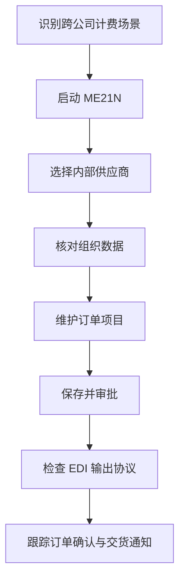

# 创建带开票的跨公司采购订单

> **用途：** 在不同内部法人或采购组织之间创建需要结算的采购订单，并通过 EDI 传输到供货方系统。  
> **Transaction Code：** `ME21N`  
> **来源文件：** `Intercompany Bestellung.docx`  
> **状态：** 历史资料整理；字段、组织值、EDI 配置和用户参数必须在当前系统验证。

## 1. 适用范围与权限

- 适用于采购、主数据维护或个人用户设置。
- 跨公司交易、价格条件、删除标识、工作流代理和用户参数均应按权限与四眼原则处理。
- 示例编号、组织值和参数值不应直接复制到生产业务。

## 2. 流程图

## 3. 页面与字段

| 页面/区域 | 字段或控件 | 填写/选择 | 说明与风险 |
|---|---|---|---|
| ME21N Kopf | Bestellart | Normalbestellung 或当前跨公司类型 | 按当前配置 |
| ME21N Kopf | Lieferant | 内部供应商主数据 | 不是普通库存调拨的供货工厂字段 |
| Kopf > OrgDaten | Einkaufsorganisation / Einkäufergruppe / Buchungskreis | 接收方组织数据 | 历史画面会带出负责人的组织信息 |
| Position | Material | 内部采购材料 | 供货方必须可销售/交付 |
| Position | Bestellmenge / Lieferdatum | 数量/要求交期 | 按实际需求 |
| Position | Nettopreis / Währung | 内部结算价格/币种 | 必须符合集团转移定价规则 |
| Nachrichten | Ausgabeart | EDI | 替代普通打印或 PDF |
| Verarbeitungsprotokoll | Status / Empfängersystem | 成功和目标系统 | 确认消息发送到正确系统 |

## 4. 详细操作

1. **场景判断**  
   仅当内部实体之间需要开票和结算时使用跨公司订单。仅内部领料或维修领用不应套用该流程。
2. **创建**  
   输入 `ME21N`，选择当前有效的订单类型。
3. **内部供应商**  
   选择供货实体对应的内部供应商主数据。
4. **组织数据**  
   在 OrgDaten 检查采购组织、采购组、公司代码以及处理人员责任。
5. **项目**  
   按普通采购订单录入材料、数量、交期、价格、税码和工厂。
6. **保存审批**  
   保存订单并完成审批。
7. **EDI 检查**  
   在消息管理中确认输出类型为 `EDI`，而不是普通打印/PDF。
8. **协议验证**  
   打开 Verarbeitungsprotokoll，确认消息成功发送到另一系统。
9. **后续**  
   跟踪供货方系统自动创建的内部销售订单、订单确认和交货通知。

## 5. 完成检查

- [ ] 确属需要开票的跨公司交易
- [ ] 内部供应商与接收组织正确
- [ ] 转移价格与币种正确
- [ ] 订单审批完成
- [ ] EDI 消息成功
- [ ] 订单确认和交货通知可追踪

## 6. 待确认事项

- ⚠️ 内部供应商名称、组织值和价格规则未写入匿名化文档。
- ⚠️ 接口可能使用 IDoc、EDI 或 S/4HANA 集成，具体消息类型和监控事务需确认。

## 7. 常见风险

- 保存成功不代表后续接口或工作流成功，必须检查状态、消息协议或测试凭证。
- 历史默认值可能已失效，应优先使用当前模板、搜索帮助和系统配置。
