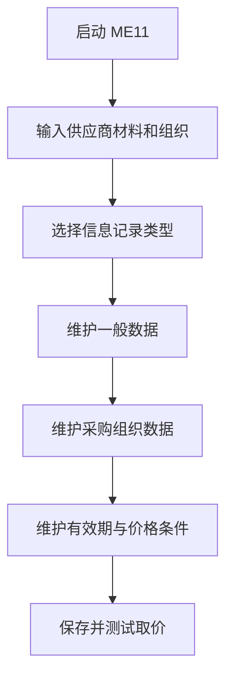

# 创建采购信息记录

> **用途：** 建立材料与供应商的采购关系，维护计划交货时间、采购组、确认控制、价格、附加条件和阶梯价格。  
> **Transaction Code：** `ME11`  
> **来源文件：** `Infosätze anlegen FERTIG.docx`  
> **状态：** 历史资料整理；字段、组织值、EDI 配置和用户参数必须在当前系统验证。

## 1. 适用范围与权限

- 适用于采购、主数据维护或个人用户设置。
- 跨公司交易、价格条件、删除标识、工作流代理和用户参数均应按权限与四眼原则处理。
- 示例编号、组织值和参数值不应直接复制到生产业务。

## 2. 流程图

## 3. 页面与字段

| 页面/区域 | 字段或控件 | 填写/选择 | 说明与风险 |
|---|---|---|---|
| ME11 Einstieg | Lieferant | 供应商号 | 必须与报价方一致 |
| ME11 Einstieg | Material | 材料号 | 本流程针对有材料号 Infosatz |
| ME11 Einstieg | Einkaufsorganisation / Werk | 采购组织/工厂 | 决定适用范围 |
| ME11 Einstieg | Infotyp | Normal / Lohnbearbeitung / Pipeline / Konsignation | 外部表面处理历史上仍使用 Normal |
| Allgemeine Daten | Lieferantenmaterialnummer | 供应商料号 | 便于订单输出和对账 |
| Allgemeine Daten | Bestellmengeneinheit / Umrechnung | 订购单位/换算 | 必须与供应商报价一致 |
| Einkaufsorganisationsdaten 1 | Planlieferzeit | 日历日 | 必填历史字段 |
| Einkaufsorganisationsdaten 1 | Einkäufergruppe | 负责采购组 | 必填历史字段 |
| Einkaufsorganisationsdaten 1 | Mindestmenge | 最小订购量 | 如适用 |
| Einkaufsorganisationsdaten 1 | BestätPflicht / BestätSteu | 勾选/控制键 | 决定 AB 要求与确认控制 |
| Einkaufsorganisationsdaten 1 | WE-bez.RP | 勾选 | 收货相关发票校验 |
| Konditionen | Gültig ab/bis | 价格有效期 | 避免开放式过期价格 |
| Konditionen | Nettopreis / Preiseinheit | 净价/价格单位 | 复核币种和每价单位 |
| Zusatzkonditionen | Zuschlag / Rabatt / Fracht | 附加条件 | 按合同维护 |
| Staffeln | Mengenstaffel | 数量和阶梯价 | 适用于价格或附加条件 |

## 4. 详细操作

1. **入口**  
   输入 `ME11`，填写供应商、材料、采购组织和工厂。
2. **类型**  
   选择 Infotyp。常规零部件使用 Normal；真正委外加工才使用 Lohnbearbeitung。
3. **一般数据**  
   维护供应商料号、订购单位、单位换算及必要的原产地/催交信息。
4. **采购组织数据**  
   维护 Planlieferzeit、采购组、最小量、确认义务、确认控制和收货相关发票校验。
5. **价格条件**  
   进入 Konditionen，设置有效期、净价、币种和价格单位。
6. **附加条件**  
   按合同加入运费、能源、金属、折扣等条件。
7. **阶梯**  
   通过 Staffeln 维护数量阶梯；有阶梯的条件行应显示标识。
8. **保存验证**  
   保存 Infosatz，使用测试采购订单验证供应商、交期、价格和条件自动带出。

## 5. 完成检查

- [ ] 供应商和材料正确
- [ ] Infotyp 正确
- [ ] 采购组织与工厂正确
- [ ] 单位换算正确
- [ ] 交货时间和采购组完整
- [ ] 价格有效期无重叠
- [ ] 附加条件与阶梯正确
- [ ] 测试订单取价通过

## 6. 待确认事项

- ⚠️ 条件类型名称因配置不同而异，不写入历史条件代码清单。
- ⚠️ WE-bez.RP 和确认义务是否强制取决于当前采购政策。

## 7. 常见风险

- 保存成功不代表后续接口或工作流成功，必须检查状态、消息协议或测试凭证。
- 历史默认值可能已失效，应优先使用当前模板、搜索帮助和系统配置。
