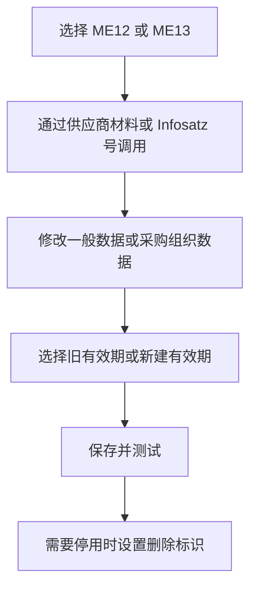

# 修改、显示及删除标识采购信息记录

> **用途：** 安全修改采购信息记录价格有效期，提供只读查看，并对不再使用的记录设置删除标识。  
> **Transaction Code：** `ME12`, `ME13`  
> **来源文件：** `Infosätze anlegen FERTIG.docx`  
> **状态：** 历史资料整理；字段、组织值、EDI 配置和用户参数必须在当前系统验证。

## 1. 适用范围与权限

- 适用于采购、主数据维护或个人用户设置。
- 跨公司交易、价格条件、删除标识、工作流代理和用户参数均应按权限与四眼原则处理。
- 示例编号、组织值和参数值不应直接复制到生产业务。

## 2. 流程图

## 3. 页面与字段

| 页面/区域 | 字段或控件 | 填写/选择 | 说明与风险 |
|---|---|---|---|
| ME12/ME13 Einstieg | Lieferant / Material | 组合查询 | 避免选错组织层级 |
| ME12/ME13 Einstieg | Infosatz | 唯一信息记录号 | 可直接定位 |
| ME12 Einstieg | Einkaufsorganisation / Werk | 当前适用范围 | 必须核对 |
| Gültigkeitszeiträume Konditionen | Auswählen | 修改选中历史区间 | 不要覆盖错误期间 |
| Gültigkeitszeiträume Konditionen | Neuer Zeitraum | 全新有效区间 | 不复制旧附加条件 |
| Gültigkeitszeiträume Konditionen | Neu mit Vorlage | 复制旧区间为模板 | 仍需逐项复核 |
| ME12 Menü > Zusätze | Löschvormerkungen | 打开 | 设置采购组织/一般层删除标识 |
| ME13 | Anzeigen | 只读 | 不能切换到修改模式 |

## 4. 详细操作

1. **调用**  
   修改用 `ME12`，显示用 `ME13`。可通过供应商+材料或唯一 Infosatz 号进入。
2. **只读场景**  
   需要第三方查看价格但不修改时优先使用 `ME13`。
3. **修改条件**  
   在 ME12 打开 Konditionen，系统列出历史有效期。
4. **选择方式**  
   Auswählen 修改现有期间；Neuer Zeitraum 新建空白期间；Neu mit Vorlage 复制所选期间的附加条件和阶梯。
5. **检查期间**  
   确保前后期间不重叠、不留非预期空档，同时复核净价、币种和价格单位。
6. **删除标识**  
   停用记录时，在 ME12 通过 Menü > Zusätze > Löschvormerkungen 设置规定层级的标识并保存。
7. **验证**  
   用 ME13 或测试订单确认旧记录不再被使用，新价格在正确日期生效。

## 5. 完成检查

- [ ] 调用的 Infosatz 和组织范围正确
- [ ] 有效期无重叠或空档
- [ ] 复制的附加条件已逐项检查
- [ ] 删除标识层级正确
- [ ] 测试订单结果正确

## 6. 待确认事项

- ⚠️ 删除标识不等于物理删除，历史采购订单仍保留引用。
- ⚠️ 源资料称需设置两个删除勾选，具体层级和字段名必须在当前系统确认。

## 7. 常见风险

- 保存成功不代表后续接口或工作流成功，必须检查状态、消息协议或测试凭证。
- 历史默认值可能已失效，应优先使用当前模板、搜索帮助和系统配置。
