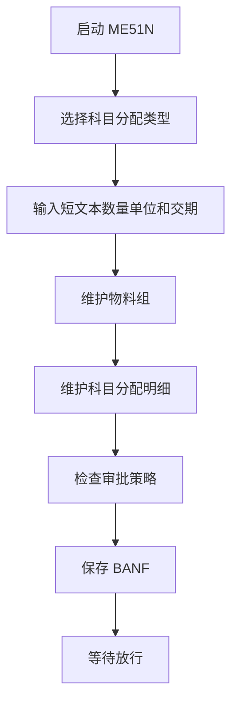

# 创建已科目分配的采购申请

> **用途：** 为外部服务、间接物料或投资需求创建带成本中心、固定资产等科目分配的 BANF，并触发审批。  
> **Transaction Code：** `ME51N`  
> **来源文件：** `Kontierte Banf und Bestellung FERTIG.docx`  
> **状态：** 历史资料整理；字段、组织值、权限和签署规则必须在当前系统及现行制度下验证。

## 1. 适用范围与权限

- 适用于采购合同、已科目分配需求、手工采购订单或个人输出签名设置。
- 合同、财务科目分配、固定资产和签署权限均属于高影响数据，应执行四眼复核。
- 示例公司、地点、供应商、人员、编号和金额不写入匿名化流程。

## 2. 流程图

## 3. 页面与字段

| 页面/区域 | 字段或控件 | 填写/选择 | 说明与风险 |
|---|---|---|---|
| ME51N Positionsübersicht | Kontierungstyp | K / A / 其他批准类型 | K=成本中心，A=固定资产 |
| Positionsübersicht | Kurztext | 清晰的采购对象描述 | 避免模糊自由文本 |
| Positionsübersicht | Menge / Mengeneinheit | 数量/单位 | 服务常见单位需按合同 |
| Positionsübersicht | Lieferdatum | 需求日期 | 现实可执行 |
| Positionsübersicht | Warengruppe | 适用物料组 | 影响审批和报表 |
| Position > Kontierung | Empfänger | 服务/物料接收人 | 历史流程中 K 类型必填 |
| Position > Kontierung | Sachkonto | 总账科目 | 由财务规则决定 |
| Position > Kontierung | Kostenstelle | 成本中心 | K 类型必填 |
| Position > Kontierung | Anlage / Unternummer | 固定资产号/子编号 | A 类型必填 |
| Position > Freigabestrategie | Freigabekennzeichen | 锁定/已放行 | 未批准前不能转订单 |

## 4. 详细操作

1. **入口**  
   输入 `ME51N`。
2. **科目分配**  
   按业务选择 Kontierungstyp。成本费用使用 `K`；资本化采购使用 `A`。
3. **项目数据**  
   填写 Kurztext、数量、单位、交期和物料组，并按 Enter 运行必填校验。
4. **成本中心**  
   K 类型在 Kontierung 页签维护 Empfänger、Sachkonto 和 Kostenstelle。
5. **固定资产**  
   A 类型维护资产号和子编号，必须与已批准的投资申请一致。
6. **审批**  
   检查项目层 Freigabestrategie。锁定标识表示 BANF 尚未获得所需审批。
7. **保存**  
   保存并记录 BANF 号。采购员只有在放行后才能正常转为采购订单。

## 5. 完成检查

- [ ] 科目分配类型正确
- [ ] 短文本和数量清晰
- [ ] 物料组正确
- [ ] 总账科目与成本中心/资产一致
- [ ] 接收人正确
- [ ] 审批策略已触发
- [ ] BANF 号已记录

## 6. 待确认事项

- ⚠️ 固定资产子编号和物料组必须按当前财务规则确认，不采用历史示例。

## 7. 常见风险

- 组织层级、科目分配或伙伴层级填写错误，会导致订单无法调用、错误记账或错误收发票地址。
- 历史示例字段可能已迁移到 BP、Fiori 或 Flexible Workflow，应以当前系统为准。
