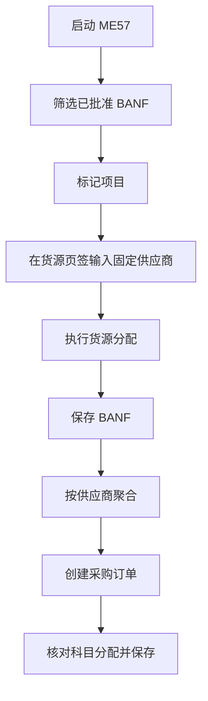

# 将已科目分配 BANF 转为采购订单

> **用途：** 为已批准的科目分配 BANF 分配固定供应商，并创建保留原科目分配的采购订单。  
> **Transaction Code：** `ME57`  
> **来源文件：** `Kontierte Banf und Bestellung FERTIG.docx`  
> **状态：** 历史资料整理；字段、组织值、权限和签署规则必须在当前系统及现行制度下验证。

## 1. 适用范围与权限

- 适用于采购合同、已科目分配需求、手工采购订单或个人输出签名设置。
- 合同、财务科目分配、固定资产和签署权限均属于高影响数据，应执行四眼复核。
- 示例公司、地点、供应商、人员、编号和金额不写入匿名化流程。

## 2. 流程图

## 3. 页面与字段

| 页面/区域 | 字段或控件 | 填写/选择 | 说明与风险 |
|---|---|---|---|
| ME57 Auswahl | Nur freigegebene Banfen | 勾选 | 只处理已批准 BANF |
| Ergebnisliste | BANF-Position | 标记 | 选择目标需求 |
| Positionsdetail > Bezugsquelle | Fester Lieferant | 供应商号 | 按报价和授权确定 |
| Positionsdetail > Bezugsquelle | Bezugsquelle zuordnen | 点击 | 确认供应源 |
| Zuordnungen | Lieferant | 供应商分组 | 同一供应商需求可合并 |
| Zuordnungen | Bestellung anlegen | 点击 | 进入订单创建 |
| ME21N | Warenkorb / BANF Positionen | 自动或拖入 | 取决于个人设置 |
| ME21N > Kontierung | Sachkonto / Kostenstelle / Anlage | 从 BANF 复制 | 必须逐项复核 |

## 4. 详细操作

1. **选择**  
   输入 `ME57`，按采购组、工厂、日期和“仅已放行 BANF”筛选。
2. **标记**  
   选择目标 BANF 行。
3. **分配**  
   在 Bezugsquelle 页签的 Fester Lieferant 输入已批准供应商，点击 Bezugsquelle zuordnen。
4. **保存**  
   保存 BANF 供应源分配。
5. **生成订单**  
   在供应商分组中标记目标供应商，点击 Bestellung anlegen。
6. **带入项目**  
   根据用户参数，BANF 可能自动进入订单，也可能需从购物车拖入。
7. **复核**  
   核对从 BANF 复制的短文本、数量、交期、价格、物料组、总账科目、成本中心或资产号。
8. **保存**  
   保存采购订单并记录订单号，进入相应审批流程。

## 5. 完成检查

- [ ] BANF 已放行
- [ ] 供应商有报价或合同依据
- [ ] 供应源分配保存成功
- [ ] 科目分配完整复制
- [ ] 价格与交期正确
- [ ] 订单号已记录

## 6. 待确认事项

- ⚠️ 自动拖入 BANF 的行为受个人参数影响。

## 7. 常见风险

- 组织层级、科目分配或伙伴层级填写错误，会导致订单无法调用、错误记账或错误收发票地址。
- 历史示例字段可能已迁移到 BP、Fiori 或 Flexible Workflow，应以当前系统为准。
