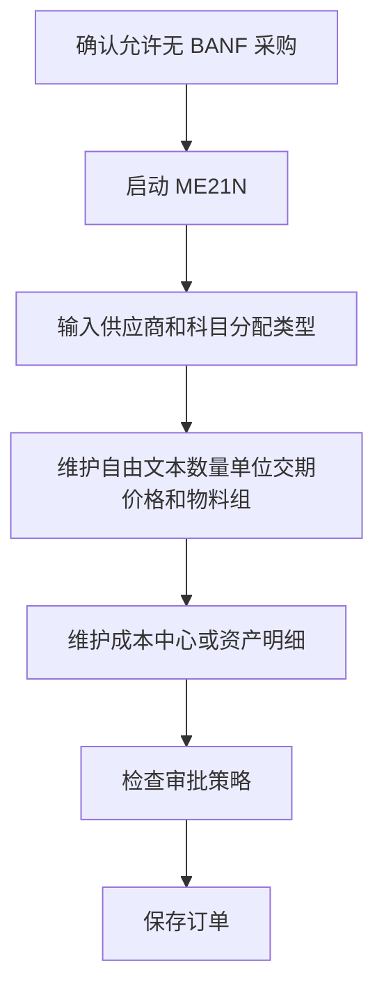

# 手工创建成本中心或固定资产采购订单

> **用途：** 在没有 BANF 的获批例外场景中，手工创建外部服务、间接采购或固定资产采购订单。  
> **Transaction Code：** `ME21N`  
> **来源文件：** `Kontierte Banf und Bestellung FERTIG.docx`  
> **状态：** 历史资料整理；字段、组织值、权限和签署规则必须在当前系统及现行制度下验证。

## 1. 适用范围与权限

- 适用于采购合同、已科目分配需求、手工采购订单或个人输出签名设置。
- 合同、财务科目分配、固定资产和签署权限均属于高影响数据，应执行四眼复核。
- 示例公司、地点、供应商、人员、编号和金额不写入匿名化流程。

## 2. 流程图

## 3. 页面与字段

| 页面/区域 | 字段或控件 | 填写/选择 | 说明与风险 |
|---|---|---|---|
| ME21N Position | Kontierungstyp | K / A | K=成本中心，A=固定资产 |
| Position | Lieferant | 供应商 | 基于已批准报价 |
| Position | Kurztext | 自由文本 | 应描述交付物而非内部备注 |
| Position | Menge / Einheit | 数量/单位 | 与报价一致 |
| Position | Lieferdatum | 期望交期 | 必须可执行 |
| Position | Nettopreis / Währung | 价格/币种 | 与报价和审批一致 |
| Position | Warengruppe | 适用物料组 | 按采购分类 |
| Position > Kontierung | Empfänger | 服务接收人 | K 类型历史必填 |
| Position > Kontierung | Sachkonto / Kostenstelle | 总账科目/成本中心 | K 类型 |
| Position > Kontierung | Anlage / Unternummer | 固定资产/子编号 | A 类型 |

## 4. 详细操作

1. **例外确认**  
   确认业务允许无 BANF 直接下单，并具备预算/投资批准。
2. **入口**  
   输入 `ME21N`，填写供应商。
3. **类型**  
   成本中心采购选择 Kontierungstyp `K`；固定资产采购选择 `A`。
4. **项目**  
   填写 Kurztext、数量、单位、交期、价格、币种和物料组。
5. **K 类型**  
   在 Kontierung 维护 Empfänger、Sachkonto 和 Kostenstelle。
6. **A 类型**  
   在 Kontierung 维护已批准资产号和子编号。
7. **复核**  
   检查税码、付款条件、附件、交货地址和审批策略。
8. **保存**  
   保存订单，记录订单号并等待审批及输出。

## 5. 完成检查

- [ ] 无 BANF 采购有正式批准
- [ ] 供应商与报价一致
- [ ] 科目分配正确
- [ ] 价格与币种正确
- [ ] 服务接收人或资产号完整
- [ ] 审批策略已触发
- [ ] 订单号已记录

## 6. 待确认事项

- ⚠️ 是否允许无 BANF 直接采购由当前采购政策决定。

## 7. 常见风险

- 组织层级、科目分配或伙伴层级填写错误，会导致订单无法调用、错误记账或错误收发票地址。
- 历史示例字段可能已迁移到 BP、Fiori 或 Flexible Workflow，应以当前系统为准。
