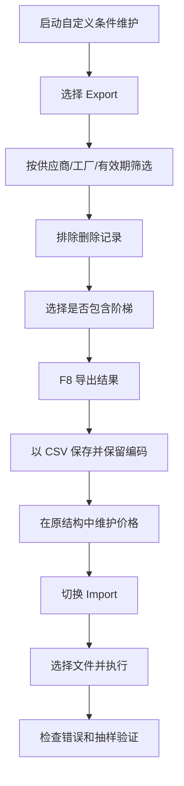

# 批量导出及导入采购信息记录价格条件

> **用途：** 从系统导出供应商采购信息记录条件模板，经谈判更新后按原格式导入价格和阶梯。  
> **Transaction Code：** `ZMMKONDITIONEN`  
> **来源文件：** `Massenkonditionspflege.docx`  
> **状态：** 历史资料整理；字段、组织值、价格导入、消息输出与主数据默认值必须在当前系统验证。

## 1. 适用范围与权限

- 适用于材料扩展、采购催交和采购信息记录批量条件维护。
- 材料估价、采购条件批量导入和催交通知均属高影响操作，应执行四眼复核。
- 示例公司、人员、供应商、材料、订单和组织编号不写入匿名化流程。

## 2. 流程图

## 3. 页面与字段

| 页面/区域 | 字段或控件 | 填写/选择 | 说明与风险 |
|---|---|---|---|
| ZMMKONDITIONEN | Export / Import | 按阶段选择 | 导出模板后再导入 |
| Export | Gültig von-bis / gültig am | 有效期范围/关键日期 | 限制有效条件 |
| Export | Werk | 目标工厂 | 源文件强调必须选择正确工厂 |
| Export | Lieferant | 供应商号 | 一次处理明确范围 |
| Export | Material / Warengruppe / Konditionsart / Infosatztyp | 可选筛选 | 进一步缩小数据 |
| Optionen | ohne Staffeln / Testlauf / inkl. Staffeln | 选择 | 决定阶梯价格范围 |
| Optionen | gelöschte Infosätze ausschl. | 勾选 | 排除删除信息记录 |
| Optionen | gelöschte Konditionen ausschl. | 勾选 | 排除删除条件 |
| ALV Ergebnis | Export als .CSV | 点击 | 生成模板文件 |
| Dateidialog | Codierung | Unicode/当前批准编码 | 避免特殊字符损坏 |
| CSV | Spaltenstruktur / Reihenfolge / Trennzeichen | 禁止改变 | 否则无法自动导入 |
| Import | Import .csv Datei | 选择更新文件 | 必须来自同一导出模板 |
| Import | Staffelpreise | 自动/按界面勾选 | 阶梯在同一行连续排列 |
| Import | Ausführen | F8 | 上传并处理 |
| Importprotokoll | Fehler / Erfolg | 检查 | 不得只凭无弹窗判断成功 |

## 4. 详细操作

1. **备份**  
   在 `ZMMKONDITIONEN` 选择 Export。
2. **筛选**  
   明确供应商、工厂、有效期和其他范围；勾选排除已删除信息记录及条件。
3. **阶梯**  
   决定不含阶梯、测试运行或包含阶梯。
4. **执行导出**  
   按 F8 生成 ALV 数据，并使用 Export als .CSV 保存。
5. **编码**  
   选择当前批准的 Unicode 编码；使用不含人员姓名的文件名。
6. **供应商维护**  
   可将模板发送供应商填写价格。谈判后由采购人员核对净价、币种、价格单位、有效期和阶梯。
7. **格式保护**  
   不得增加、删除、移动列，不得改变分隔符、表头和阶梯排列。
8. **导入测试**  
   切换 Import，先使用少量记录或测试运行。选择 CSV 文件并执行。
9. **错误处理**  
   检查错误消息或处理日志，修正数据后重新导入。
10. **验证**  
   抽样用 `ME13` 或测试订单检查价格、有效期、价格单位和阶梯是否正确。

## 5. 完成检查

- [ ] 导出范围只有目标供应商和工厂
- [ ] 删除记录已排除
- [ ] 原始导出已备份
- [ ] CSV 结构未改变
- [ ] 币种/价格单位/有效期已复核
- [ ] 先小批量测试
- [ ] 导入日志无错误
- [ ] ME13/测试订单抽样通过

## 6. 待确认事项

- ⚠️ `ZMMKONDITIONEN` 为自定义事务，当前字段和导入规则须实机确认。
- ⚠️ 源文件截图含供应商、用户和本地路径，均未写入 Repository。

## 7. 常见风险

- 量产或批量操作前先使用少量测试对象，并保存导出文件和处理日志。
- 不要使用历史截图中的组织值、价格、材料状态或联系人。
- 批量消息发送前不得勾选跳过预览的选项。
