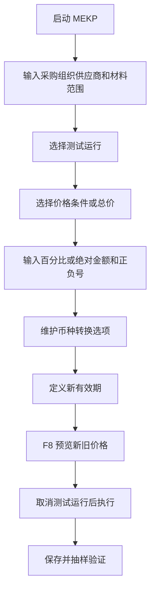

# 使用 MEKP 批量调整采购信息记录价格

> **用途：** 对一个供应商的一个或多个材料按相同绝对值或百分比调整价格，并建立新的有效期。  
> **Transaction Code：** `MEKP`, `ME12`, `ME13`, `ZMMKONDITIONEN`  
> **来源文件：** `Preisänderung Infosatz mekp.docx`  
> **状态：** 历史资料整理；字段、有效期、消息类型、处理媒介和自定义配置必须在当前系统验证。

## 1. 适用范围与权限

- 适用于货源清单、采购信息记录价格调整和经典消息控制。
- 固定供应源、价格批量变更及 NACE 条件记录均属高影响配置，应执行四眼复核并保留变更证据。
- 示例公司、人员、供应商、材料、价格、订单和组织编号不写入匿名化流程。

## 2. 流程图

## 3. 页面与字段

| 页面/区域 | 字段或控件 | 填写/选择 | 说明与风险 |
|---|---|---|---|
| MEKP Auswahl | Einkaufsorganisation | 目标采购组织 | 限定条件记录 |
| MEKP Auswahl | Lieferant | 供应商号 | 一次处理明确供应商 |
| MEKP Auswahl | Material von/bis / Mehrfachselektion | 单个、范围或清单 | 多材料必须使用同一增减规则 |
| MEKP Auswahl | Infosätze ohne Material | 按需要勾选 | 确认是否包含无材料号 Infosatz |
| MEKP Auswahl | Testlauf | 首次勾选 | 只预览，不写入 |
| Konditionsart oder Bruttopreis ändern | Konditionsart | 特定条件类型 | 只变更指定条件 |
| Konditionsart oder Bruttopreis ändern | Bruttopreis | 勾选 | 变更总价条件 |
| Änderungswert | Prozentwert | 相对增减百分比 | 所有选中材料相同 |
| Änderungswert | Absoluter Betrag | 绝对增减金额 | 所有选中材料相同 |
| Änderungswert | Vorzeichen | + / - | 明确涨价或降价 |
| Währung ändern | Kurstyp / Kursdatum / Alte-Neue Währung | 按需要 | 价格币种转换 |
| Währung ändern | Zusatzkonditionen | 勾选/取消 | 决定附加条件是否一起处理 |
| Kondition gültig | am / von-bis | 生效日或有效期 | 创建新的价格期间 |
| Ergebnis | Alter Zustand / Neuer Zustand | 对比 | 保存前核对 |

## 4. 详细操作

1. **入口**  
   输入 `MEKP`，维护采购组织、供应商和材料。其调用逻辑类似 `ME12`，但用于统一批量调整。
2. **范围**  
   可输入单个材料、材料区间或通过多重选择逐项粘贴材料号。
3. **测试**  
   首次运行保持 `Testlauf` 勾选，只生成预览。
4. **变化规则**  
   选择特定 Konditionsart 或 Bruttopreis；输入 Prozentwert 或 Absoluter Betrag，并确认正负号。
5. **币种**  
   只有需要时才维护货币转换；检查汇率类型和汇率日期。
6. **附加条件**  
   确认 Zusatzkonditionen 是否一并处理，避免遗漏或重复涨价。
7. **有效期**  
   定义新价格的生效日或 von/bis 区间。
8. **预览**  
   按 F8 检查 Alter Zustand 与 Neuer Zustand，重点核对币种、价格单位和新有效期。
9. **正式执行**  
   确认无误后取消 Testlauf，再次执行并保存。
10. **验证**  
   用 `ME13` 或测试订单抽样检查；不同材料需要不同涨幅时，使用 `ME12` 单独维护或 `ZMMKONDITIONEN` 批量导入。

## 5. 完成检查

- [ ] 供应商和采购组织正确
- [ ] 材料范围正确
- [ ] 首次运行使用测试模式
- [ ] 增减正负号正确
- [ ] 价格单位和币种正确
- [ ] 新有效期无重叠
- [ ] 附加条件处理决定明确
- [ ] 正式执行后 ME13 抽样通过

## 6. 待确认事项

- ⚠️ 多材料只能应用相同绝对值或百分比；不同涨幅不得混在一次 MEKP 运行中。

## 7. 常见风险

- 有效期重叠会产生多个同时有效的供应源或价格条件。
- 删除或重新生成货源清单记录可能丢失固定供应源和 MRP 标识。
- 消息控制条件记录错误会造成未发送、重复发送或发送到错误渠道。
