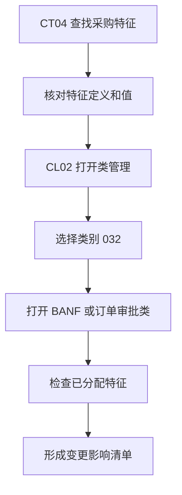

# 分析采购审批策略的特征与分类

> **用途：** 查看采购审批策略使用的特征、类和判定维度，为后续调整审批人或金额边界提供依据。  
> **Transaction Code：** `CT04`, `CL02`  
> **来源文件：** `Freigabeverfahren ändern FERTIG.docx`  
> **状态：** 历史培训资料整理；字段、权限、状态码、自定义对象和金额阈值必须在当前系统验证。

## 1. 适用范围与权限

- 适用于采购、主数据、审批策略或输出管理相关岗位。
- 修改分类、特征、审批人、金额边界或输出规则属于高风险配置，应在开发/测试系统验证并执行四眼复核。
- 生产系统变更必须有变更单、测试证据、回退方案和审批记录。

## 2. 流程图

## 3. 页面与字段

| 页面/区域 | 字段或控件 | 填写/选择 | 说明与风险 |
|---|---|---|---|
| CT04 Einstieg | Merkmal | MM* | 历史资料中 MM 前缀用于采购相关特征 |
| Merkmalverwaltung | Gültig ab / Änderungsnr. | 按当前变更控制 | 修改特征时需有效日期 |
| CL02 Einstieg | Klassenart | 032 | Freigabestrategie |
| CL02 Auswahl | Klasse | MM_AZ_BANFFREIGABE | BANF 审批类历史名称 |
| Klasse ändern > Merkmale | MM_BELEGARTBANF | 采购申请凭证类型 | 审批判定维度 |
| Klasse ändern > Merkmale | MM_KONTIERUNGSTYP | 科目分配类型 | 审批判定维度 |
| Klasse ändern > Merkmale | MM_WERKBANF | 工厂 | 审批判定维度 |
| Klasse ändern > Merkmale | MM_WERTPOSITION | 项目总值 | 金额边界 |
| Klasse ändern > Merkmale | MM_USER | 经办人名称 | 人员或用户判定 |

## 4. 详细操作

1. **特征检索**  
   用 `CT04` 输入 `MM*` 并打开选择帮助，查看采购侧特征。
2. **特征分析**  
   逐个查看数据类型、长度、允许值、单位和有效性。若只需分析，不要进入修改模式。
3. **类管理**  
   用 `CL02`，Klassenart 输入 `032`。
4. **BANF 类**  
   选择 `MM_AZ_BANFFREIGABE`，进入 Merkmale 页签，记录分配的特征及顺序。
5. **影响评估**  
   确认拟修改的人员、工厂、凭证类型、科目分配和金额边界是否被其他策略共用。
6. **变更准备**  
   形成测试矩阵，至少覆盖边界值以下、等于边界、边界以上，以及不同采购组/工厂/凭证类型。

## 5. 完成检查

- [ ] 仅在授权系统分析或修改
- [ ] 类别 032 正确
- [ ] 目标类和特征名称正确
- [ ] 数据类型与单位已核对
- [ ] 共用策略影响已识别
- [ ] 测试矩阵已准备

## 6. 待确认事项

- ⚠️ MM*、类别 032 和类名来自历史配置，当前系统可能已迁移或重命名。

## 7. 常见风险

- 错误的分类值或边界会导致凭证无法进入审批、进入错误策略，或被错误人员批准。
- 自定义输出消息重新启动、删除或重发前，必须核对凭证、收件人、附件和审批状态。
- 历史示例编号仅用于说明，不应直接复制到当前系统。
