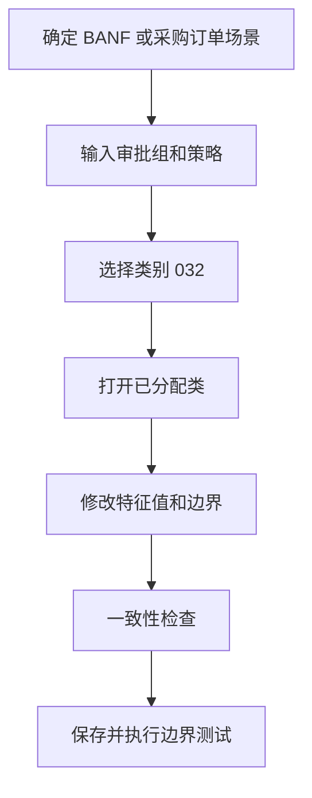

# 使用 CL20N 调整 BANF 与采购订单审批策略

> **用途：** 按审批组和策略修改审批人员、采购组、工厂、凭证类型及金额区间。  
> **Transaction Code：** `CL20N`  
> **来源文件：** `Freigabeverfahren ändern FERTIG.docx`  
> **状态：** 历史培训资料整理；字段、权限、状态码、自定义对象和金额阈值必须在当前系统验证。

## 1. 适用范围与权限

- 适用于采购、主数据、审批策略或输出管理相关岗位。
- 修改分类、特征、审批人、金额边界或输出规则属于高风险配置，应在开发/测试系统验证并执行四眼复核。
- 生产系统变更必须有变更单、测试证据、回退方案和审批记录。

## 2. 流程图

## 3. 页面与字段

| 页面/区域 | 字段或控件 | 填写/选择 | 说明与风险 |
|---|---|---|---|
| CL20N Auswahl | FreigGruppe | 01 | 历史资料中 01=BANF |
| CL20N Auswahl | FrgStrategie | 负责区域策略代码 | 历史示例 19、06 |
| CL20N Auswahl | Klassenart | 032 | Freigabestrategie |
| CL20N Zuordnungen | Klasse | MM_AZ_BANFFREIGABE | BANF 审批类 |
| Bewertung BANF | Belegart Bestellanforderung | NB 等 | 采购申请类型 |
| Bewertung BANF | Kontierungstyp | K 等 | 科目分配类型 |
| Bewertung BANF | Werk | 实际工厂 | 不要复制历史示例 |
| Bewertung BANF | Gesamtwert der Position | 金额条件 | 检查币种与包含/排除边界 |
| Bewertung BANF | Name des Sachbearbeiters | 有效 SAP 用户 | 人员列表 |
| CL20N Auswahl | FreigGruppe | 02 | 历史资料中 02=采购订单 |
| CL20N Zuordnungen | Klasse | MM_AZ_BESTFREIGABE | 订单审批类历史名称 |
| Bewertung Bestellung | Bestellart | FO/NB 等 | 采购订单类型 |
| Bewertung Bestellung | Einkaufsorganisation | 实际采购组织 | 组织判定 |
| Bewertung Bestellung | Gesamter Bestellnettowert | 金额区间 | 复核币种和上下限 |
| Bewertung Bestellung | Einkäufergruppe | 采购组列表 | 新增/删除需审批 |

## 4. 详细操作

1. **确定对象**  
   BANF 使用 Freigabegruppe `01`；采购订单使用 `02`。选择负责区域的 FrgStrategie 和 Klassenart `032`。
2. **打开分配**  
   点击 Ändern 或 Anzeigen，双击类分配行进入 Bewertung。
3. **BANF 规则**  
   核对凭证类型、科目分配、工厂、项目总值和经办人。只修改获批的人员或边界。
4. **订单规则**  
   核对 Bestellart、采购组织、订单净值区间和采购组。
5. **修改值**  
   使用底部按钮新增、删除或调整特征值。不要删除仍有业务使用的采购组或用户。
6. **一致性检查**  
   运行系统一致性检查，处理重叠、遗漏或无效值。
7. **保存**  
   保存变更并记录 transport/change request。
8. **测试**  
   创建测试 BANF/订单，覆盖金额临界值。例如边界为 2,500 与 50,000 时，至少测试 2,499.99、2,500.00、49,999.99、50,000.00。
9. **回归**  
   验证旧策略、跨工厂、不同科目分配和代理审批仍正常。

## 5. 完成检查

- [ ] 变更单和批准存在
- [ ] 01/02 审批组没有混淆
- [ ] 金额单位和币种正确
- [ ] 人员/采购组有效
- [ ] 无策略重叠或空档
- [ ] 边界值测试通过
- [ ] 旧流程回归通过

## 6. 待确认事项

- ⚠️ 历史示例中的人员姓名、区域策略、金额和采购组不写入流程，避免错误复用。
- ⚠️ 部分系统的审批策略已由 Flexible Workflow 替代，需确认是否仍使用经典分类。

## 7. 常见风险

- 错误的分类值或边界会导致凭证无法进入审批、进入错误策略，或被错误人员批准。
- 自定义输出消息重新启动、删除或重发前，必须核对凭证、收件人、附件和审批状态。
- 历史示例编号仅用于说明，不应直接复制到当前系统。

## 8. 定期用户复核

1. 在 `CL20N` 使用 Klassenart `032` 和 Freigabegruppe `01`，逐一检查 BANF 的全部 Freigabestrategie。
2. 将策略中的用户与当前组织、离职和岗位变更清单比对。
3. 替换无效用户或删除不再承担审批职责的用户。禁止在文档中保留历史人员姓名或邮箱。
4. 变更后创建测试 BANF，验证新用户收到审批任务，旧用户不再获得权限。
5. 记录变更单、执行人、测试证据和上线日期。
