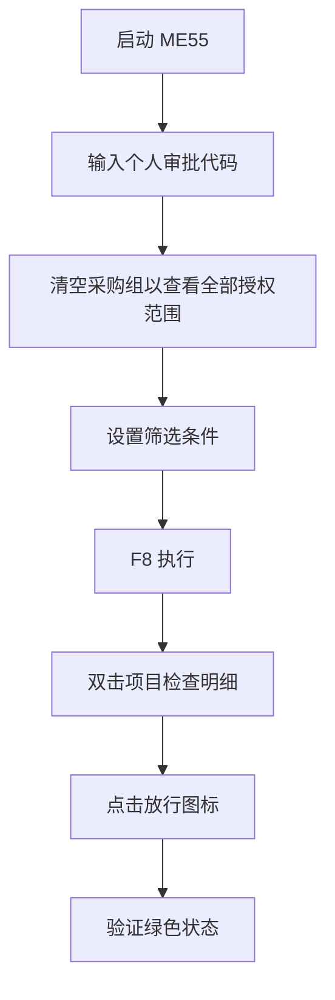

# 批量审批已科目分配的采购申请

> **用途：** 按审批代码列出未批准的手工或已科目分配 BANF，并执行批量放行。  
> **Transaction Code：** `ME55`  
> **来源文件：** `Freigabeverfahren kontierte Banf FERTIG.docx`  
> **状态：** 历史流程整理；审批代码、策略、权限和通知渠道必须在当前系统验证。

## 1. 适用范围与权限

- 仅供拥有相应 Freigabecode 和凭证权限的审批人员使用。
- 审批前必须核对需求、数量、价格、交期、科目分配、供应源及预算依据。
- 拒绝或撤销审批会中断采购流程，必须通知凭证创建人或负责采购员并记录原因。

## 2. 流程图

## 3. 页面与字段

| 页面/区域 | 字段或控件 | 填写/选择 | 说明与风险 |
|---|---|---|---|
| ME55 Einstieg | Freigabecode | 个人授权代码 | 不得借用其他审批人的代码 |
| ME55 Einstieg | Einkäufergruppe | 通常清空 | 历史流程要求清空以查看全部待批 BANF |
| ME55 Einstieg | Freigabevoraussetzung erfüllt | 勾选 | 只显示满足前置审批的项目 |
| ME55 Einstieg | Banfen zur Gesamtfreigabe | 按策略勾选 | 整体放行场景 |
| ME55 Einstieg | Banfen zur Positionsfreigabe | 按策略勾选 | 项目级放行场景 |
| ME55 Einstieg | Listumfang | ALV | 便于筛选和排序 |
| ME55 Einstieg | Werk / Belegart / Kontierungstyp | 按需限制 | 批量审批前应缩小范围 |
| Ergebnisliste | 铅笔与勾选图标 | 点击 | 执行当前审批级别的放行 |
| Ergebnisliste | 绿色勾选 | 放行成功 | 状态改变后仍需确认后续审批层级 |

## 4. 详细操作

1. **启动**  
   输入 `ME55`。
2. **审批身份**  
   填写本人 Freigabecode。采购组字段按历史流程清空，以显示授权范围内全部待批 BANF。
3. **限制范围**  
   按工厂、凭证类型、科目分配、日期和采购申请号缩小清单。
4. **执行**  
   点击 Ausführen 或按 F8。
5. **明细审查**  
   双击项目号查看 BANF 明细，包括材料/短文本、数量、交期、成本对象和申请人。ME55 中只读检查，不能修改或撤回放行。
6. **放行**  
   回到清单，点击行首“铅笔与勾选”图标。成功后图标变为绿色勾选。
7. **结果确认**  
   检查是否仍需下一层审批，并确认状态没有因并发修改失效。

## 5. 完成检查

- [ ] 审批代码属于本人
- [ ] 筛选范围正确
- [ ] BANF 需求和成本对象合理
- [ ] 异常项目已单独检查
- [ ] 绿色勾选出现
- [ ] 后续审批层级明确

## 6. 待确认事项

- ⚠️ 清空 Einkäufergruppe 是否仍符合当前授权和数据保护要求需确认。
- ⚠️ 整体放行与项目放行取决于当前策略设计。

## 7. 控制要求

- 不得使用他人的个性化 Freigabecode。
- 批量审批前应抽查凭证明细；异常项目必须单独打开审查。
- SAP 内部消息不应包含敏感个人数据，只保留凭证号、拒绝原因和下一步要求。
