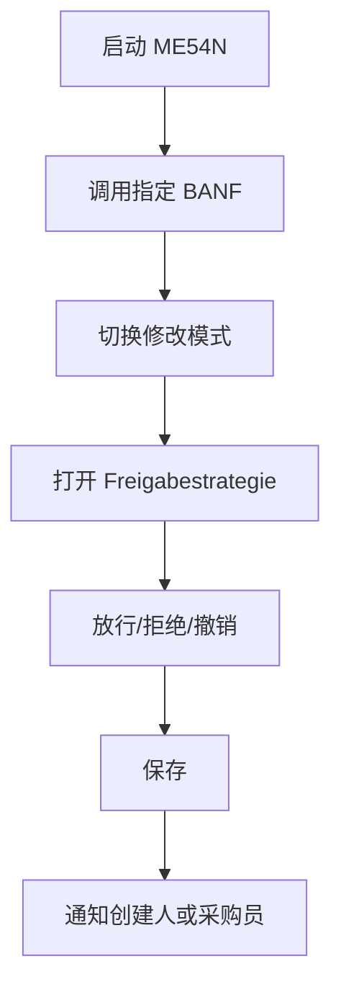

# 单笔审批、拒绝或撤销采购申请

> **用途：** 对指定 BANF 进行单笔审批、拒绝或撤销已授予的审批。  
> **Transaction Code：** `ME54N`  
> **来源文件：** `Freigabeverfahren kontierte Banf FERTIG.docx`  
> **状态：** 历史流程整理；审批代码、策略、权限和通知渠道必须在当前系统验证。

## 1. 适用范围与权限

- 仅供拥有相应 Freigabecode 和凭证权限的审批人员使用。
- 审批前必须核对需求、数量、价格、交期、科目分配、供应源及预算依据。
- 拒绝或撤销审批会中断采购流程，必须通知凭证创建人或负责采购员并记录原因。

## 2. 流程图

## 3. 页面与字段

| 页面/区域 | 字段或控件 | 填写/选择 | 说明与风险 |
|---|---|---|---|
| ME54N | 其他凭证 双方框图标 | 点击 | 调用指定 BANF |
| Beleg selektieren | Bestellanforderung | 输入 BANF 号 | 确认选择采购申请而非订单 |
| Toolbar | 眼镜与铅笔 | 点击 | 从显示切换修改模式 |
| Position | Freigabestrategie | 页签 | 查看审批组、策略、代码和状态 |
| Freigabestrategie | 铅笔与勾选 | 点击 | 授予当前审批级别 |
| Freigabestrategie | 绿色回退箭头 | 点击 | 撤回本人可撤销的审批 |
| Freigabestrategie | Ablehnen | 点击 | 拒绝 BANF |
| Position | Ansprechpartner | 页签 | 查找创建人/申请人/采购员 |
| System > Kurzmitteilung | Objekt mit Notiz senden | 选择 | 发送 SAP 内部通知 |

## 4. 详细操作

1. **调用凭证**  
   输入 `ME54N`，点击其他凭证图标并输入 BANF 号。
2. **进入修改**  
   点击“眼镜与铅笔”切换 Bearbeitungsmodus。
3. **检查**  
   在项目页签核对物料或短文本、数量、交期、科目分配、供应源、价格依据和 Ansprechpartner。
4. **放行**  
   进入 Freigabestrategie，点击放行图标。
5. **撤销**  
   需要重新锁定时点击绿色回退箭头并保存。撤销前检查是否已有后续订单。
6. **拒绝**  
   点击 Ablehnen。拒绝后 BANF 可继续显示给采购员，但不能转采购订单；有权限的人员可撤销拒绝。
7. **保存**  
   保存状态变化。
8. **通知**  
   在 Ansprechpartner 找到负责人员，通过 System > Kurzmitteilung > Objekt mit Notiz senden 说明凭证号、拒绝原因和需要的修正，点击信封发送。

## 5. 完成检查

- [ ] 凭证号正确
- [ ] 修改模式已启用
- [ ] 审批/拒绝理由有依据
- [ ] 撤销前检查后续订单
- [ ] 状态已保存
- [ ] 创建人或采购员已通知

## 6. 待确认事项

- ⚠️ 当前系统可能使用邮件或工作流通知替代 SAP Office 短消息。
- ⚠️ 拒绝后 BANF 的后续可见性和可修改性需按当前策略验证。

## 7. 控制要求

- 不得使用他人的个性化 Freigabecode。
- 批量审批前应抽查凭证明细；异常项目必须单独打开审查。
- SAP 内部消息不应包含敏感个人数据，只保留凭证号、拒绝原因和下一步要求。
