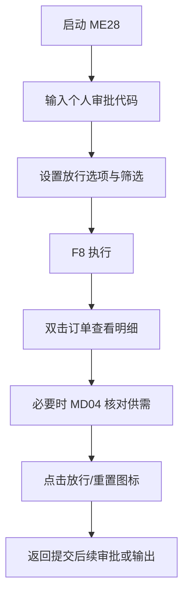

# 批量审批采购订单

> **用途：** 按审批代码批量检查采购订单，并在需要时通过 MD04 核对材料的供需情况。  
> **Transaction Code：** `ME28`, `MD04`  
> **来源文件：** `Freigabeverfahren Bestellungen FERTIG.docx`  
> **状态：** 历史流程整理；审批代码、策略、权限和通知渠道必须在当前系统验证。

## 1. 适用范围与权限

- 仅供拥有相应 Freigabecode 和凭证权限的审批人员使用。
- 审批前必须核对需求、数量、价格、交期、科目分配、供应源及预算依据。
- 拒绝或撤销审批会中断采购流程，必须通知凭证创建人或负责采购员并记录原因。

## 2. 流程图

## 3. 页面与字段

| 页面/区域 | 字段或控件 | 填写/选择 | 说明与风险 |
|---|---|---|---|
| ME28 Einstieg | Freigabecode | 个人授权代码 | 个性化审批权限 |
| ME28 Einstieg | Freigabe setzen | 勾选 | 执行放行 |
| ME28 Einstieg | Freigabe rücksetzen | 仅撤销场景勾选 | 不要与放行场景混淆 |
| ME28 Einstieg | Freigabevoraussetzung erfüllt | 勾选 | 只显示满足前置审批的订单 |
| ME28 Einstieg | Listumfang | BEST | 历史列表范围 |
| ME28 Einstieg | Einkaufsbelegtyp / Einkaufsorganisation / Belegart / Einkäufergruppe | 按需筛选 | 批量审批应尽量限定范围 |
| ME28 Ergebnis | Position/Belegnummer | 双击 | 进入订单明细 |
| MD04 Einstieg | Material / Dispobereich / Werk | 从订单复制并核对 | 检查真实需求和现有供应 |
| ME28 Ergebnis | 放行图标 | 点击 | 授予或重置当前审批级别 |
| ME28 | Zurück | 点击 | 历史流程中返回即提交处理 |

## 4. 详细操作

1. **启动**  
   输入 `ME28`，填写本人 Freigabecode。
2. **模式**  
   正常审批勾选 Freigabe setzen；撤销时使用 Freigabe rücksetzen。
3. **筛选**  
   限定采购组织、订单类型、采购组、供应商或日期，避免超范围批量处理。
4. **执行**  
   按 F8 显示待批订单。
5. **订单审查**  
   双击订单号进入详情，检查供应商、材料、数量、净价、条件、交期、付款条件、附件和科目分配。
6. **需求审查**  
   如需判断是否确有需求，复制材料号，在另一个会话打开 `MD04`，核对负需求、现有采购订单和可用数量。
7. **放行/撤销**  
   回到 ME28，点击目标行的放行图标。图标显示当前状态。
8. **提交**  
   历史流程通过 Zurück 提交并转下一审批层级或输出，不要求额外保存。当前系统应观察状态栏确认。

## 5. 完成检查

- [ ] 审批代码本人所有
- [ ] 筛选范围合理
- [ ] 供应商/价格/数量/交期已核对
- [ ] MD04 未发现重复供应
- [ ] 放行状态正确
- [ ] 后续审批或输出已触发

## 6. 待确认事项

- ⚠️ “返回即提交、无需保存”是历史行为，当前系统可能不同，必须以状态栏和重新进入后的状态验证。
- ⚠️ MD04 中的采购订单号码范围不写入匿名化流程。

## 7. 控制要求

- 不得使用他人的个性化 Freigabecode。
- 批量审批前应抽查凭证明细；异常项目必须单独打开审查。
- SAP 内部消息不应包含敏感个人数据，只保留凭证号、拒绝原因和下一步要求。
