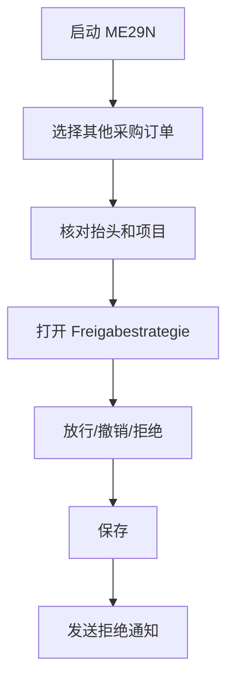

# 单笔审批、拒绝或撤销采购订单

> **用途：** 对指定采购订单执行单笔审批、拒绝或撤销，并通知负责采购员。  
> **Transaction Code：** `ME29N`  
> **来源文件：** `Freigabeverfahren Bestellungen FERTIG.docx`  
> **状态：** 历史流程整理；审批代码、策略、权限和通知渠道必须在当前系统验证。

## 1. 适用范围与权限

- 仅供拥有相应 Freigabecode 和凭证权限的审批人员使用。
- 审批前必须核对需求、数量、价格、交期、科目分配、供应源及预算依据。
- 拒绝或撤销审批会中断采购流程，必须通知凭证创建人或负责采购员并记录原因。

## 2. 流程图

## 3. 页面与字段

| 页面/区域 | 字段或控件 | 填写/选择 | 说明与风险 |
|---|---|---|---|
| ME29N | Andere Bestellung | 点击 | 选择目标采购订单 |
| Beleg auswählen | Bestellnummer | 采购订单号 | 避免误选相邻订单 |
| Kopf | Freigabestrategie | 页签 | 查看审批组、策略、代码和状态 |
| Freigabestrategie | 放行图标 | 点击 | 授予当前审批级别 |
| Freigabestrategie | 撤销图标 | 点击 | 撤销可回退审批 |
| Freigabestrategie | Ablehnen | 点击 | 拒绝订单 |
| System > Kurzmitteilung | Objekt mit Notiz senden | 选择 | 通知采购员 |
| Dokument erstellen und senden | Dokumentinhalt | 拒绝原因和下一步 | 保持简洁、具体 |
| Dokument erstellen und senden | Empfänger / Sofort informieren | 采购员 SAP 用户/勾选 | 立即提醒 |

## 4. 详细操作

1. **选择订单**  
   输入 `ME29N`，选择 Andere Bestellung 并输入订单号。
2. **审查**  
   检查供应商、净价、数量、交期、付款条款、货币、科目分配、附件和审批策略。
3. **放行**  
   在 Kopf > Freigabestrategie 点击放行图标并保存。
4. **撤销**  
   需要重新锁定时点击撤销图标并保存；先确认订单是否已输出、收货或开票。
5. **拒绝**  
   点击 Ablehnen 并保存。订单保留但不应发送；其来源 BANF 通常已视为完成，不会自动重新出现。
6. **通知**  
   拒绝后必须通知负责采购员。通过对象服务选择 Objekt mit Notiz senden，写明订单号、拒绝原因和需采取的措施。
7. **发送**  
   选择正确 SAP 用户，勾选立即通知并点击信封。

## 5. 完成检查

- [ ] 订单号正确
- [ ] 价格和交期审核完成
- [ ] 拒绝/撤销考虑了收货与输出状态
- [ ] 变更已保存
- [ ] 采购员已收到通知
- [ ] 后续修正负责人明确

## 6. 待确认事项

- ⚠️ 来源 BANF 在拒绝订单后是否自动恢复开放需求，必须按当前系统验证，不能假设。
- ⚠️ 内部 SAP 消息可能已被工作流通知取代。

## 7. 控制要求

- 不得使用他人的个性化 Freigabecode。
- 批量审批前应抽查凭证明细；异常项目必须单独打开审查。
- SAP 内部消息不应包含敏感个人数据，只保留凭证号、拒绝原因和下一步要求。
