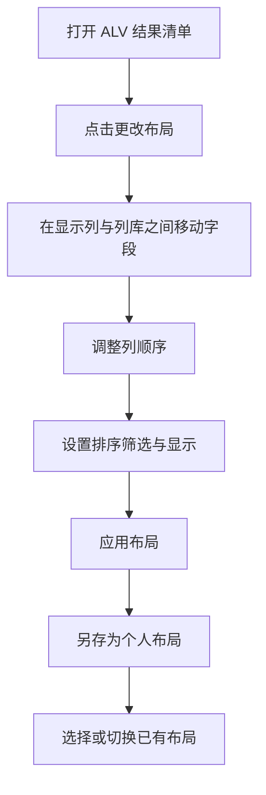

# 调整、保存并选择 ALV 列表布局

> **用途：** 在采购申请、订单和报表清单中选择显示列、调整顺序、排序和筛选，并保存个人布局。  
> **Transaction Code：**   
> **来源文件：** `Layout bei Auflistungen anpassen.docx`  
> **状态：** 历史资料整理；字段、组织值、权限和默认布局必须在当前系统验证。

## 1. 适用范围与权限

- 适用于列表报表、供应商主数据或工厂级合同维护。
- 主数据、合同价格、合同监控和默认布局设置均可能影响其他用户或后续采购，应按权限操作。
- 示例公司、人员、供应商、材料、合同号和组织编号不写入匿名化流程。

## 2. 流程图

## 3. 页面与字段

| 页面/区域 | 字段或控件 | 填写/选择 | 说明与风险 |
|---|---|---|---|
| ALV Toolbar | Layout ändern 彩色方块 | 点击 | 打开布局设置 |
| Layout ändern > Spaltenauswahl | Angezeigte Spalten | 当前显示列 | 左侧历史界面 |
| Layout ändern > Spaltenauswahl | Spaltenvorrat | 未显示列 | 右侧历史界面 |
| Spaltenauswahl | 左右箭头 | 添加/移除列 | 先标记字段 |
| Spaltenauswahl | 上下箭头 | 调整顺序 | 决定列表从左到右位置 |
| Layout ändern | Sortierung / Filter / Ansicht / Darstellung | 按需要维护 | 影响排序、筛选和视觉显示 |
| ALV Toolbar | Layout sichern 表格加软盘图标 | 点击 | 保存当前布局 |
| Layout sichern | Layout | 不含姓名或敏感信息的短名称 | 遵循团队命名规则 |
| Layout sichern | Bezeichnung | 用途说明 | 例如“采购申请审批概览” |
| Layout sichern | Benutzerspezifisch | 勾选 | 仅本人可用，默认推荐 |
| Layout sichern | Voreinstellung | 谨慎勾选 | 设为该报表的默认显示 |
| ALV Toolbar | Layout auswählen | 点击 | 查看并激活已有布局 |

## 4. 详细操作

1. **打开报表**  
   运行目标事务并进入 ALV 列表。
2. **更改布局**  
   点击工具栏“彩色方块”图标。
3. **配置列**  
   从 Spaltenvorrat 将价格、交期、数量、审批状态等字段移入 Angezeigte Spalten；不用的字段移回列库。
4. **调整顺序**  
   利用上下箭头定义显示顺序。
5. **高级设置**  
   按需要维护 Sortierung、Filter、Ansicht 和 Darstellung。
6. **应用**  
   点击绿色勾选，将布局应用到当前列表。
7. **保存**  
   点击“表格+软盘”图标，输入匿名、可识别用途的布局名和描述。
8. **作用范围**  
   勾选 Benutzerspezifisch，避免影响其他用户。仅在确定该事务应始终使用此布局时设置 Voreinstellung。
9. **切换**  
   使用 Layout auswählen 查看所有可用布局并激活目标布局。

## 5. 完成检查

- [ ] 显示列满足业务检查
- [ ] 价格/币种/数量/交期单位完整
- [ ] 排序与筛选没有隐藏重要记录
- [ ] 布局名称不含人员信息
- [ ] Benutzerspezifisch 已正确设置
- [ ] 默认布局决定有依据

## 6. 待确认事项

- ⚠️ “Voreinstellung”通常是当前报表或用户上下文的默认值，源文件称适用于所有报表；当前作用范围必须实机确认。
- ⚠️ 不同 ALV 版本图标和字段左右位置可能相反。

## 7. 常见风险

- 用户默认布局和全局布局必须区分，避免覆盖其他人员的报表显示。
- 供应商扩展时不得创建重复主记录；财务、采购和语言相关文本应分别复核。
- 合同只有完成审批后才能作为有效供应源进入货源清单或 MRP 自动分配。
