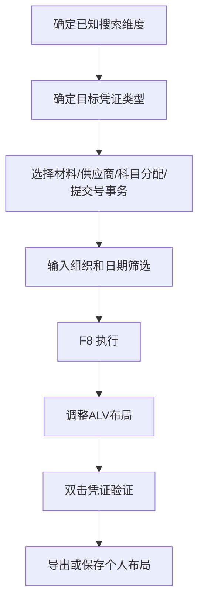

# 按材料、供应商、科目分配或提交号搜索采购凭证

> **用途：** 根据已知数据选择正确的列表事务，搜索信息记录、采购订单、框架协议、询价和采购申请。  
> **Transaction Code：** `ME1M`, `ME1L`, `ME2M`, `ME2L`, `ME2K`, `ME3M`, `ME3L`, `ME4M`, `ME4L`, `ME4S`, `ME5A`  
> **来源文件：** `Suchfunktion Belege.docx`  
> **状态：** 历史资料整理；字段、状态、命名规则与工作流必须在当前系统验证。

## 1. 适用范围与权限

- 适用于标准文本、工程变更工作流或采购凭证查询。
- 多语言文本、工程变更状态和跨部门工作流均可能影响外部输出或主数据放行，应执行四眼复核。
- 示例公司、人员、地点、材料、凭证和组织编号不写入匿名化流程。

## 2. 流程图

## 3. 页面与字段

| 页面/区域 | 字段或控件 | 填写/选择 | 说明与风险 |
|---|---|---|---|
| Infosatz | ME1M | 按材料 | 查看材料对应信息记录 |
| Infosatz | ME1L | 按供应商 | 查看供应商对应信息记录 |
| Bestellung | ME2M | 按材料 | 查看材料采购订单 |
| Bestellung | ME2L | 按供应商 | 查看供应商采购订单 |
| Bestellung | ME2K | 按科目分配 | 按成本中心、资产、PSP 等查订单 |
| Rahmenvertrag | ME3M | 按材料 | 查看材料框架协议 |
| Rahmenvertrag | ME3L | 按供应商 | 查看供应商框架协议 |
| Anfrage | ME4M | 按材料 | 查看材料询价 |
| Anfrage | ME4L | 按供应商 | 查看供应商询价 |
| Anfrage | ME4S | 按 Submission | 按提交关键字/批次查询价 |
| BANF | ME5A | 采购申请清单 | 结合自由选择筛选 |

## 4. 详细操作

1. **判断目标**  
   先确定要找的是信息记录、采购订单、框架协议、询价还是 BANF。
2. **判断维度**  
   再判断已知的是材料号、供应商、科目分配、Submission、采购组、工厂或日期。
3. **选择事务**  
   材料维度通常使用后缀 `M`，供应商维度使用 `L`；订单科目分配使用 `ME2K`；询价 Submission 使用 `ME4S`。
4. **筛选**  
   输入已知参数，并增加采购组织、工厂、采购组、凭证日期和删除标识等范围，避免全量查询。
5. **执行**  
   按 F8 运行列表。
6. **布局**  
   显示凭证号、项目、供应商、材料、数量、金额、币种、交期和状态等关键列。
7. **验证**  
   双击目标凭证，核对抬头和项目详情，避免只凭列表短文本判断。
8. **复用**  
   保存为个人 ALV 布局或变式；需要进一步分析时导出 Excel。

## 5. 完成检查

- [ ] 目标凭证类型明确
- [ ] 搜索维度正确
- [ ] 组织和日期范围合理
- [ ] 删除/完成状态已考虑
- [ ] 结果列包含关键字段
- [ ] 目标凭证已打开验证
- [ ] 布局为个人范围

## 6. 待确认事项

- ⚠️ 不同列表事务的选择参数与输出字段并不完全相同。
- ⚠️ 大范围查询可能影响性能，应逐步放宽条件。

## 7. 常见风险

- 标准文本缺少目标语言时，输出凭证可能完全不打印该文本。
- 工程变更状态跳转可能绕过部门维护和验证，不得无审批跳过。
- 查询结果取决于筛选条件、组织范围和布局，必须抽查凭证明细。
