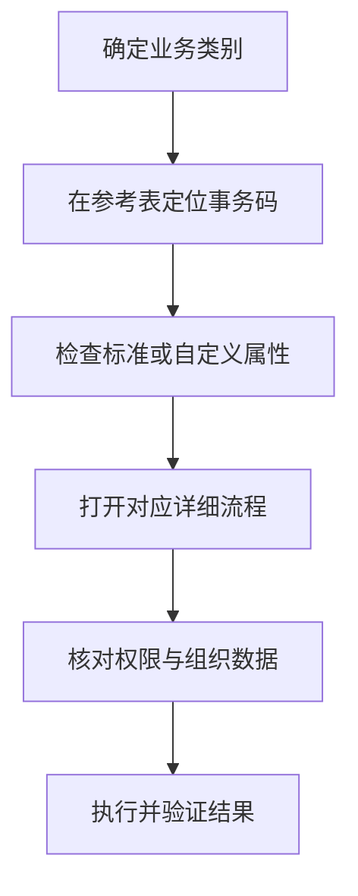

# 采购与主数据 Transaction Code 参考

> **用途：** 提供按业务类别整理的采购、MRP、发运、报表和主数据事务码索引，并标记自定义事务需要验证。  
> **Transaction Code：**   
> **来源文件：** `Übersicht SAP Transaktionscode.xlsx`  
> **状态：** 历史资料整理；自定义字段、阈值、状态码、报表逻辑及事务码必须在当前系统验证。

## 1. 适用范围与权限

- 适用于框架协议监控、合同续签准备及采购事务码导航。
- 阈值、合同状态和监控变式会影响续签优先级，应由合同负责人及采购主管复核。
- 示例公司、品牌、人员、供应商、材料、合同号、地点和组织编号不写入匿名化流程。

## 2. 流程图

## 3. 页面与字段

| 页面/区域 | 字段或控件 | 填写/选择 | 说明与风险 |
|---|---|---|---|
| Referenzdatei | TRANSACTION_REFERENCE.csv | UTF-8; 分号分隔 | 可在 Excel 或 GitHub 中打开 |
| Anfrage | ME41/42/43/47/49/ME4*/ME91A | 询价与报价 | 详细流程见采购目录 |
| BANF | ME51N/52N/53N/54N/55/57/5A | 采购申请 | 创建、修改、审批和分配 |
| Bestellung | ME21N/22N/23N/2*/28/29N/91F/92F | 采购订单 | 创建、查询、审批和催收 |
| Infosatz | ME11/12/13/1*/ZMMKONDITIONEN | 采购信息记录 | 价格与批量条件 |
| Kontrakt | ME31K/32K/33K/3*/9K/92K | 合同 | 创建、查询、输出和催收 |
| Custom | /JA41/* / Z* | 自定义事务 | 版本、权限和功能必须实机确认 |

## 4. 详细操作

1. **分类**  
   先确定业务属于询价、BANF、订单、信息记录、合同、供应商、材料、MRP、发运、报表还是 Customizing。
2. **定位**  
   在 `TRANSACTION_REFERENCE.csv` 按类别或事务码搜索。
3. **详细说明**  
   事务码列表只负责导航。实际操作必须进入 README 中对应的独立流程文件。
4. **自定义事务**  
   以 `/JA41/` 或 `Z` 开头的事务由本地开发或附加解决方案提供，不能假设在其他系统可用。
5. **冲突检查**  
   如事务描述与当前 SAP 标题不一致，以当前系统标题、官方技术信息和已验证流程为准。
6. **维护**  
   每轮新增流程后同步更新 README Transaction Code 索引和参考 CSV。

## 5. 完成检查

- [ ] 类别与业务场景匹配
- [ ] 标准/自定义事务已区分
- [ ] 详细流程已阅读
- [ ] 权限和组织数据正确
- [ ] 当前系统标题已核对
- [ ] 参考表无人员或公司信息

## 6. 待确认事项

- ⚠️ 源表将 MD51 描述为计划独立需求创建，但现有资料用于项目级计划运行，已在参考表标记为需要验证。
- ⚠️ ME2ON 的短描述可能因委外加工功能而不同。

## 7. 常见风险

- 阈值缺失时相应信号灯可能保持不活动，不能据此判断合同无风险。
- 合同消耗量、消耗金额和截止日期使用不同口径，应分别验证。
- 自定义事务和状态表可能已迁移或停用。
