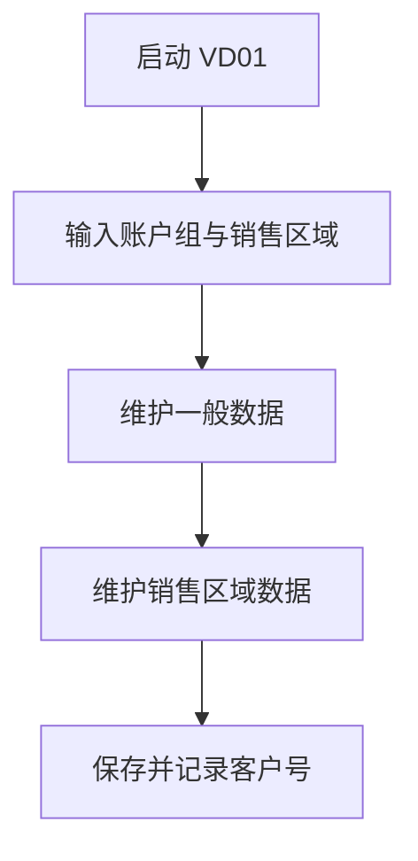

# 创建客户主数据

> **用途：** 创建销售所需的客户一般数据与销售区域数据。  
> **SAP Transaction Code：** `VD01`  
> **来源：** `2018_11_07-SAL_Handbuch.docx`  
> **状态：** 从历史培训资料整理，执行前须在当前 SAP 系统验证字段、权限和组织数据。

## 1. 前置条件

- 确认客户不存在，避免重复 Debitor
- 准备账户组、销售组织、分销渠道、产品组、地址、税号、付款与交货条件

## 2. 流程图

## 3. 页面与字段填写

| SAP 页面/区域 | 字段或控件 | 填写/选择 | 注意事项 |
|---|---|---|---|
| Debitor anlegen: Einstieg | Kontengruppe | Z001/Z002/Z006 等适用 Z 账户组 | 账户组决定可见字段和编号规则 |
| Vertriebsbereich | Verkaufsorganisation | 例如 1000 | 按实际法人/工厂选择 |
| Vertriebsbereich | Vertriebsweg | 例如 10 | 按国内、国际、服务等选择 |
| Vertriebsbereich | Sparte | 例如 10 | 保存后不可随意更改销售区域 |
| Allgemeine Daten > Adresse | Name / Straße / Ort / PLZ | 客户法定信息 | Suchbegriff 1 可用城市，Suchbegriff 2 可用客户简称 |
| Steuerungsdaten | USt-IdNr. / Transportzone | 按客户资料 | 税务字段必须核对 |
| Vertriebsdaten > Verkauf | Verkaufsbüro / Verkaufsgruppe / Währung | 按责任和合同 | 默认币种将进入销售单据 |
| Versand | Lieferpriorität / Werk / Versandbedingung | 按物流规则 | 检查是否允许部分交货 |
| Faktura | Incoterms / Zahlungsbedingung / Steuerklassifikation | 按合同与税务 | 税分类 0/1 必须正确 |
| Partnerrollen | AG/WE/RE/RG | 确认合作伙伴 | 默认可均为客户本人 |

## 4. 详细操作

1. **打开事务**  
   在命令框输入 `VD01` 并回车。
2. **填写入口屏幕**  
   选择账户组，填写销售组织、分销渠道和产品组。
3. **维护一般数据**  
   依次填写地址、控制数据、营销、卸货点、出口数据和联系人中适用字段。
4. **维护销售区域数据**  
   填写销售、发运、开票和合作伙伴功能。
5. **保存**  
   点击保存，记录状态栏返回的客户号。

## 5. 完成检查

- [ ] 客户去重搜索已完成
- [ ] 税号与法定名称一致
- [ ] 付款条件和 Incoterms 已复核
- [ ] AG/WE/RE/RG 角色正确
- [ ] 客户号已记录

## 6. 常见风险

- 不要把“能显示”误认为“已保存”，必须确认 SAP 状态栏出现成功消息和生成的单据号。
- 如果字段与本文不一致，优先检查事务代码、凭证类型、组织层级、用户权限和 SAP 版本。
- 涉及价格、库存、会计凭证、放行或删除标识时，遵循四眼原则和公司权限矩阵。
