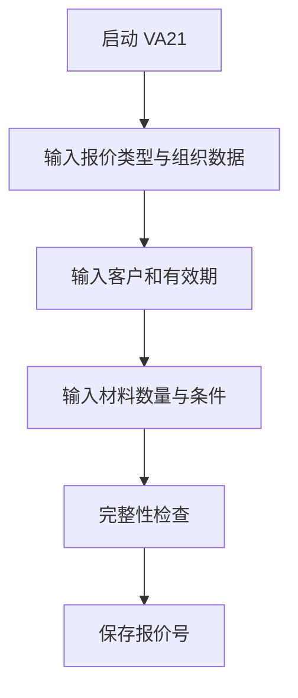

# 创建报价

> **用途：** 创建、修改、显示和查询销售报价。  
> **SAP Transaction Code：** `VA21`, `VA22`, `VA23`, `VA25N`  
> **来源：** `2018_11_07-SAL_Handbuch.docx`  
> **状态：** 从历史培训资料整理，执行前须在当前 SAP 系统验证字段、权限和组织数据。

## 1. 前置条件

- 客户主数据与销售区域已维护
- 材料号、数量、价格、有效期和客户询价参考已准备

## 2. 流程图

## 3. 页面与字段填写

| SAP 页面/区域 | 字段或控件 | 填写/选择 | 注意事项 |
|---|---|---|---|
| Angebot anlegen | Angebotsart | 按业务场景 | 必须与销售区域兼容 |
| Organisationsdaten | VkOrg / VtWeg / Sparte | 实际组织值 | 与客户主数据一致 |
| Positionsübersicht | Auftraggeber | 客户号 | Warenempfänger 通常自动带出 |
| Positionsübersicht | Bestellnummer / Bestelldatum | 客户参考/日期 | 保留客户追踪依据 |
| Positionsübersicht | Gültig bis | 报价有效期 | 不可遗漏 |
| Position | Material / Auftragsmenge | 材料号/数量 | 多材料分多行 |
| Konditionen Pos. | PR00 / ZRA4 等 | 价格/折扣 | 手工覆盖须按授权 |

## 4. 详细操作

1. **创建入口**  
   输入 `VA21`，填写报价类型与组织数据。
2. **填写抬头**  
   输入 Auftraggeber、客户参考、报价日期、有效期、期望交期。
3. **填写行项目**  
   输入 Material 和 Auftragsmenge，回车触发主数据和定价。
4. **检查价格**  
   选中项目进入 Konditionen Pos.，复核 PR00 和折扣。
5. **保存**  
   运行完整性检查后保存并记录报价号；查询可用 `VA25N`。

## 5. 完成检查

- [ ] 报价有效期已填
- [ ] 客户参考已填
- [ ] 数量和单位正确
- [ ] 价格与折扣已授权
- [ ] 报价号已记录

## 6. 常见风险

- 不要把“能显示”误认为“已保存”，必须确认 SAP 状态栏出现成功消息和生成的单据号。
- 如果字段与本文不一致，优先检查事务代码、凭证类型、组织层级、用户权限和 SAP 版本。
- 涉及价格、库存、会计凭证、放行或删除标识时，遵循四眼原则和公司权限矩阵。
