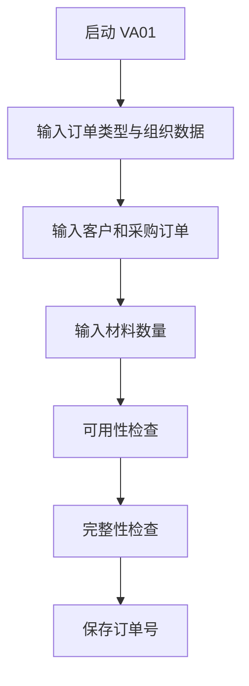

# 创建客户订单

> **用途：** 创建、修改、显示和查询客户订单。  
> **SAP Transaction Code：** `VA01`, `VA02`, `VA03`, `VA05`, `VA05N`  
> **来源：** `2018_11_07-SAL_Handbuch.docx`  
> **状态：** 从历史培训资料整理，执行前须在当前 SAP 系统验证字段、权限和组织数据。

## 1. 前置条件

- 客户与材料主数据可用
- 确认订单类型、组织数据、客户 PO、数量、交期和价格

## 2. 流程图

## 3. 页面与字段填写

| SAP 页面/区域 | 字段或控件 | 填写/选择 | 注意事项 |
|---|---|---|---|
| Kundenauftrag anlegen | Auftragsart | 按业务场景 | 决定后续交付和开票 |
| Organisationsdaten | VkOrg / VtWeg / Sparte | 实际组织值 | 必须与客户匹配 |
| Verkauf | Auftraggeber | 客户号 | 地址与 Warenempfänger 自动带出 |
| Verkauf | Bestellnummer / Bestelldatum | 客户 PO/日期 | 关键追溯字段 |
| Verkauf | Wunschlieferdatum | 客户要求日期 | 系统可能默认未来 7 个工作日 |
| Position | Material / Auftragsmenge | 材料号/数量 | 回车后触发 ATP |
| Konditionen Pos. | PR00 / Rabatte | 复核价格 | 覆盖价格需授权 |

## 4. 详细操作

1. **进入事务**  
   输入 `VA01`，填写订单类型和组织数据。
2. **维护抬头**  
   填写 Auftraggeber、客户 PO、日期和 Wunschlieferdatum。
3. **维护项目**  
   输入材料与数量，回车接受主数据。
4. **处理 ATP**  
   如弹出可用性检查，选择完整交货或交货建议，不选择会丢失差额数量的“一次性交货到期望日”。
5. **完整性检查**  
   处理 Unvollständigkeitsprotokoll 中所有缺失字段。
6. **保存**  
   保存并记录订单号；`VA02` 修改，`VA03` 显示，`VA05/VA05N` 查询。

## 5. 完成检查

- [ ] 订单类型正确
- [ ] 客户 PO 正确
- [ ] 期望交期已确认
- [ ] ATP 选择未丢失差额数量
- [ ] 完整性检查通过
- [ ] 订单号已记录

## 6. 常见风险

- 不要把“能显示”误认为“已保存”，必须确认 SAP 状态栏出现成功消息和生成的单据号。
- 如果字段与本文不一致，优先检查事务代码、凭证类型、组织层级、用户权限和 SAP 版本。
- 涉及价格、库存、会计凭证、放行或删除标识时，遵循四眼原则和公司权限矩阵。
