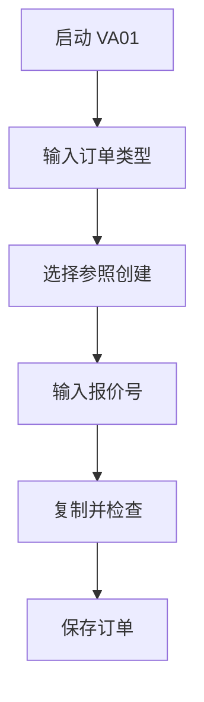

# 从报价创建订单

> **用途：** 将报价数据和条件复制到客户订单，减少重复录入。  
> **SAP Transaction Code：** `VA01`  
> **来源：** `2018_11_07-SAL_Handbuch.docx`  
> **状态：** 从历史培训资料整理，执行前须在当前 SAP 系统验证字段、权限和组织数据。

## 1. 前置条件

- 报价号已知且未完成/取消
- 订单类型和组织数据与报价一致

## 2. 流程图

## 3. 页面与字段填写

| SAP 页面/区域 | 字段或控件 | 填写/选择 | 注意事项 |
|---|---|---|---|
| VA01 Einstieg | Auftragsart | 与报价兼容的订单类型 | 至少必须填订单类型 |
| Mit Bezug anlegen | Register Angebot | 选择 Angebot | 不要选错 Auftrag/Faktura |
| Angebot | Angebotsnummer | 报价号 | 可使用搜索条件 |
| Auftragsübersicht | 客户/材料/数量/价格 | 复核复制结果 | 必要时在授权范围内修改 |

## 4. 详细操作

1. **启动**  
   输入 `VA01` 并填写订单类型及所需组织数据。
2. **参照创建**  
   点击“Mit Bezug anlegen”，选择 Angebot 页签。
3. **输入报价**  
   填写报价号并执行复制。
4. **复核**  
   检查客户、材料、数量、交期与价格条件。
5. **保存**  
   保存并记录订单号。

## 5. 完成检查

- [ ] 报价未过期或已完全复制
- [ ] 组织数据一致
- [ ] 复制数量正确
- [ ] 条件价格一致
- [ ] 订单号已记录

## 6. 常见风险

- 不要把“能显示”误认为“已保存”，必须确认 SAP 状态栏出现成功消息和生成的单据号。
- 如果字段与本文不一致，优先检查事务代码、凭证类型、组织层级、用户权限和 SAP 版本。
- 涉及价格、库存、会计凭证、放行或删除标识时，遵循四眼原则和公司权限矩阵。
