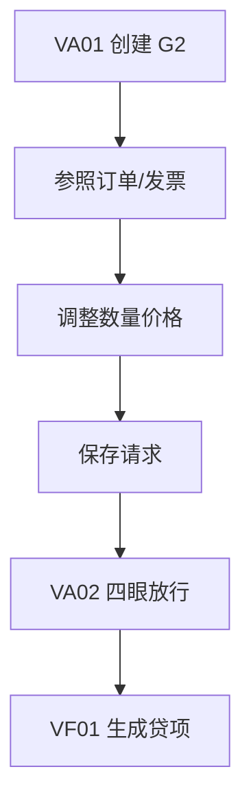

# 创建与放行贷项通知请求

> **用途：** 基于订单或发票创建 G2 贷项通知请求、解除开票冻结并生成贷项。  
> **SAP Transaction Code：** `VA01`, `VA02`, `VF01`  
> **来源：** `2018_11_07-SAL_Handbuch.docx`  
> **状态：** 从历史培训资料整理，执行前须在当前 SAP 系统验证字段、权限和组织数据。

## 1. 前置条件

- 原订单或发票号已知
- 退款原因、数量和金额已批准
- 创建人与放行人分离

## 2. 流程图

## 3. 页面与字段填写

| SAP 页面/区域 | 字段或控件 | 填写/选择 | 注意事项 |
|---|---|---|---|
| VA01 | Auftragsart | G2 | 贷项通知请求 |
| Mit Bezug anlegen | Auftrag 或 Faktura | 原始凭证号 | 优先参照创建 |
| Verkauf | Fakturasperre | 08 Gutschrift prüfen | 系统自动设置 |
| Verkauf | Auftragsgrund | 退款原因 | 用于统计 |
| Position | Zielmenge | 贷项数量 | 空值可能导致全部数量 |
| Konditionen | PR00 | 批准的调整金额 | 复核符号和币种 |
| VA02 | Fakturasperre | 清空 | 由独立审批人执行 |
| VF01 | Beleg | 贷项请求号 | 生成 G2 贷项 |

## 4. 详细操作

1. **创建请求**  
   `VA01` 选择 G2，并参照原订单或发票。
2. **调整范围**  
   填写原因、目标数量，必要时调整 PR00。
3. **保存**  
   保存贷项请求号，保留 Fakturasperre 08。
4. **四眼放行**  
   审批人用 `VA02` 检查后清空 Fakturasperre。
5. **开票**  
   用 `VF01` 输入贷项请求号并保存生成贷项凭证。

## 5. 完成检查

- [ ] 原始凭证引用正确
- [ ] 目标数量非误操作全量
- [ ] 金额和币种批准
- [ ] 放行人与创建人分离
- [ ] 贷项凭证号已记录

## 6. 常见风险

- 不要把“能显示”误认为“已保存”，必须确认 SAP 状态栏出现成功消息和生成的单据号。
- 如果字段与本文不一致，优先检查事务代码、凭证类型、组织层级、用户权限和 SAP 版本。
- 涉及价格、库存、会计凭证、放行或删除标识时，遵循四眼原则和公司权限矩阵。
