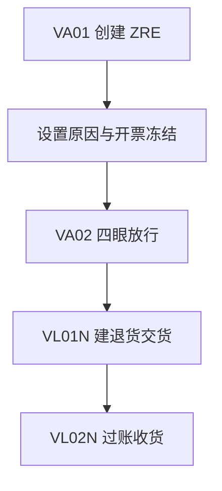

# 客户退货处理

> **用途：** 创建 ZRE 退货订单、放行、创建退货入库交货并过账收货。  
> **SAP Transaction Code：** `VA01`, `VA02`, `VL01N`, `VL02N`  
> **来源：** `2018_11_07-SAL_Handbuch.docx`  
> **状态：** 从历史培训资料整理，执行前须在当前 SAP 系统验证字段、权限和组织数据。

## 1. 前置条件

- 原销售凭证与退货授权已确认
- 退货材料、数量、原因、收货地点已明确

## 2. 流程图

## 3. 页面与字段填写

| SAP 页面/区域 | 字段或控件 | 填写/选择 | 注意事项 |
|---|---|---|---|
| VA01 | Auftragsart | ZRE | 退货订单类型 |
| Retoure anlegen | Auftraggeber / Auftragsgrund | 客户/原因 | Fakturadatum 应在未来 |
| Position | Material / Menge | 退货材料/数量 | 核对单位 |
| VA02 | Fakturasperre | 审批后清空 | 可等实物到货后再解除 |
| VL01N | Versandstelle | 实际退货收货点 | 历史示例为国际发运点 |
| VL01N | Auftrag | 退货订单号 | Selektionsdatum 覆盖需要的日期 |
| VL02N | Anlieferung | 退货交货号 | 点击过账收货 |

## 4. 详细操作

1. **创建退货订单**  
   `VA01` 选择 ZRE，填写客户、原因、日期、材料和数量。
2. **保存与审批**  
   保存退货号，由另一人通过 `VA02` 检查并解除冻结。
3. **建立退货交货**  
   `VL01N` 填写 Versandstelle、退货订单号和选择日期。
4. **保存交货**  
   记录退货交货号。
5. **过账收货**  
   `VL02N` 打开退货交货并过账 Wareneingang。

## 5. 完成检查

- [ ] ZRE 类型正确
- [ ] 退货原因与数量正确
- [ ] 四眼放行完成
- [ ] 退货交货号已记录
- [ ] 收货过账成功

## 6. 常见风险

- 不要把“能显示”误认为“已保存”，必须确认 SAP 状态栏出现成功消息和生成的单据号。
- 如果字段与本文不一致，优先检查事务代码、凭证类型、组织层级、用户权限和 SAP 版本。
- 涉及价格、库存、会计凭证、放行或删除标识时，遵循四眼原则和公司权限矩阵。
