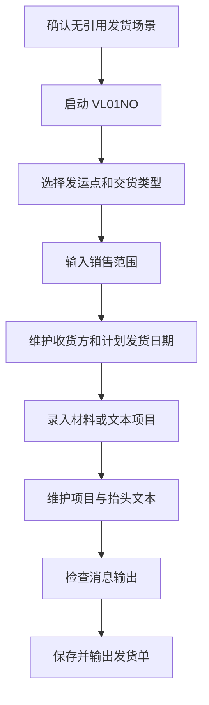

# 手工创建无订单引用的发货单

> **用途：** 在没有销售订单或其他前置单据时创建外向交货，支持有材料号项目和纯文本项目。  
> **Transaction Code：** `VL01NO`, `VL02N`, `VL03N`  
> **来源文件：** `Lieferschein manuell erstellen.docx`  
> **状态：** 历史资料整理；字段、组织值、库存类型、消息输出和质量工作流必须在当前系统验证。

## 1. 适用范围与权限

- 适用于发运、供应商质量、采购退货或供应商绩效管理。
- 库存过账、退货订单、质量措施关闭及供应商评价历史归档均应执行四眼复核。
- 示例公司、人员、供应商、材料、订单和地点编号不写入匿名化流程。

## 2. 流程图

## 3. 页面与字段

| 页面/区域 | 字段或控件 | 填写/选择 | 说明与风险 |
|---|---|---|---|
| VL01NO Einstieg | Versandstelle | 当前批准发运点 | 包裹和自提场景可能不同 |
| VL01NO Einstieg | Lieferart | LO 或当前无引用交货类型 | 按当前配置 |
| Vertriebsbereich | Verkaufsorganisation / Vertriebsweg / Sparte | 实际销售范围 | 不可照搬历史数值 |
| Lieferung ohne Ref. Übersicht | Warenempfänger | 收货方客户号 | 供应商收货时使用其关联客户号 |
| Kopf | Plan-Warenausgangsdatum | 计划发货日期 | 应与提货/运输计划一致 |
| Kopf | Gesamtgewicht / Anzahl Packst. | 重量/件数 | 如适用 |
| Positionsübersicht | Material | 材料号 | 有主数据的发运项目 |
| Positionsübersicht | Liefermenge / ME | 发货数量/单位 | 与实物一致 |
| Positionsübersicht | Positionstyp | 文本项目类型 | 无材料号时由系统确定或手工选择 |
| Positionsdetail > Texte | Positionstext | 项目说明 | 必要时描述尺寸、用途或检验要求 |
| Kopf-Informationen | Kopftext | 整单说明 | 只写外部可见内容 |
| Menü > Zusätze > Liefernachrichten | Kopf | 消息控制 | 检查 PDF/纸质输出 |

## 4. 详细操作

1. **场景确认**  
   确认不存在需要引用的销售订单、采购订单或退货单据，且允许使用无引用交货。
2. **入口**  
   输入 `VL01NO`，选择当前有效发运点和交货类型。历史值只作参考，不写入流程。
3. **销售范围**  
   维护销售组织、分销渠道和产品组，按 Enter 进入处理。
4. **收货信息**  
   填写 Warenempfänger 和 Plan-Warenausgangsdatum。若需具体联系人/地址，使用信封或地址功能维护。
5. **项目**  
   有材料号时输入材料、数量和单位；无材料号货物可使用文本项目。
6. **文本**  
   双击项目进入详情，在 Texte 页签维护项目说明；整单说明在 Kopf-Informationen 中维护。
7. **输出控制**  
   通过 Liefernachrichten 检查消息类型、媒介、伙伴、语言和立即输出设置。
8. **保存**  
   保存生成交货号并启动批准的 PDF/纸质输出。
9. **后续**  
   修改用 `VL02N`，只读显示或再次输出检查用 `VL03N`。

## 5. 完成检查

- [ ] 无引用场景有业务依据
- [ ] 发运点和销售范围正确
- [ ] 收货方和地址正确
- [ ] 材料/文本项目数量正确
- [ ] 发货日期和重量件数正确
- [ ] 外部文本已复核
- [ ] 输出消息正确
- [ ] 交货号已记录

## 6. 待确认事项

- ⚠️ VL01NO 的字母 O 与数字 0 容易混淆，事务码为 `VL01NO`。
- ⚠️ 供应商作为收货方时必须存在有效客户关联。

## 7. 常见风险

- 不得把历史组织值、库存地点、税码或消息类型直接用于当前业务。
- 退货引用原始采购订单的设置会影响开放数量、收货和会计，必须按流程明确决定。
- 供应商评价若覆盖历史数据，必须先完成外部归档。
