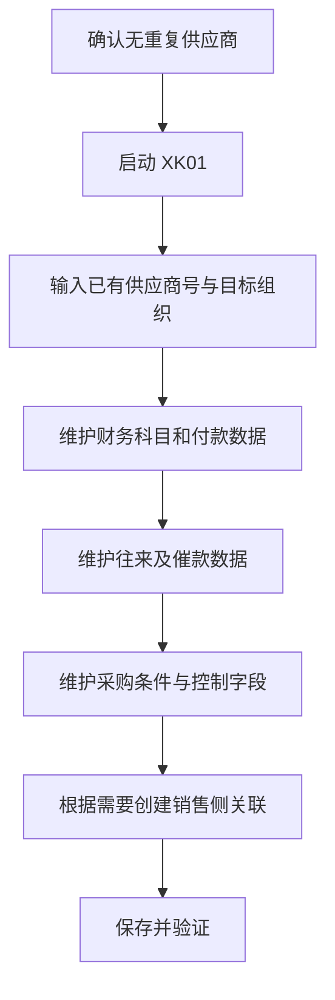

# 将现有供应商扩展至公司代码和采购组织

> **用途：** 使用已有供应商号，将供应商扩展到新的公司代码和采购组织，并维护财务及采购必填字段。  
> **Transaction Code：** `XK01`  
> **来源文件：** `Lieferant anlegen in Werk xk01.docx`  
> **状态：** 历史资料整理；字段、组织值、权限和默认布局必须在当前系统验证。

## 1. 适用范围与权限

- 适用于列表报表、供应商主数据或工厂级合同维护。
- 主数据、合同价格、合同监控和默认布局设置均可能影响其他用户或后续采购，应按权限操作。
- 示例公司、人员、供应商、材料、合同号和组织编号不写入匿名化流程。

## 2. 流程图

## 3. 页面与字段

| 页面/区域 | 字段或控件 | 填写/选择 | 说明与风险 |
|---|---|---|---|
| XK01 Einstieg | Kreditor | 已有供应商号 | 扩展现有记录，不生成重复号 |
| XK01 Einstieg | Buchungskreis | 目标公司代码 | 实际使用组织 |
| XK01 Einstieg | Einkaufsorganisation | 目标采购组织 | 实际使用组织 |
| Kontoführung Buchhaltung | Abstimmkonto | 财务批准的统驭科目 | 历史数字不保留 |
| Kontoführung Buchhaltung | Finanzdispositionsgruppe | 当前财务组 | 按财务规则 |
| Zahlungsverkehr Buchhaltung | Zahlungsbedingung | 批准的付款条件 | 与合同/报价一致 |
| Zahlungsverkehr Buchhaltung | Zahlwege | 允许付款方式 | 由财务确认 |
| Korrespondenz Buchhaltung | Sachbearbeiter Buchhaltung | 负责代码 | 按当前职责 |
| Einkaufsdaten | Bestellwährung | 采购币种 | 与供应商报价一致 |
| Einkaufsdaten | Zahlungsbedingung | 采购付款条件 | 与财务视图协调 |
| Einkaufsdaten | WE-bez.RechnPrüfung | 按政策勾选 | 无收货时限制发票校验 |
| Einkaufsdaten | Bestätigungspflicht / Bestätigungssteuerung | 按政策维护 | 控制订单确认 |
| Einkaufsdaten | Ret. mit Versandabw. / Versandbedingung | 按退货流程 | 如供应商涉及带发运退货 |
| Mini-Debitor | Vertriebsweg | 当前规定渠道 | 仅在系统提示需要销售侧关联时 |

## 4. 详细操作

1. **查重**  
   通过供应商搜索、税号、银行和地址确认供应商已存在，且确应扩展而非新建。
2. **入口**  
   输入 `XK01`，填写已有供应商号、目标公司代码和采购组织。
3. **财务科目**  
   维护统驭科目、财务计划组、付款条件、付款方式、付款冻结、催款和往来负责人。
4. **采购数据**  
   维护订单币种、采购付款条件、Incoterms、最小订单金额及必要控制字段。
5. **控制项**  
   按政策设置收货相关发票校验、确认义务、确认控制和退货发运标识。
6. **销售关联**  
   若系统要求 Mini-Debitor 或退货发运关联，按当前销售组织规则创建，不照搬历史渠道值。
7. **保存**  
   保存扩展。
8. **验证**  
   用显示事务或测试采购订单确认新公司代码和采购组织均可用。

## 5. 完成检查

- [ ] 供应商查重完成
- [ ] 公司代码和采购组织正确
- [ ] 统驭科目由财务批准
- [ ] 付款条件和方式正确
- [ ] 采购币种正确
- [ ] 确认与发票控制符合政策
- [ ] 测试订单通过

## 6. 待确认事项

- ⚠️ XK01 在较新系统中可能被 BP 取代。
- ⚠️ 源文件包含真实供应商和历史财务代码，匿名化文档不保留。

## 7. 常见风险

- 用户默认布局和全局布局必须区分，避免覆盖其他人员的报表显示。
- 供应商扩展时不得创建重复主记录；财务、采购和语言相关文本应分别复核。
- 合同只有完成审批后才能作为有效供应源进入货源清单或 MRP 自动分配。
