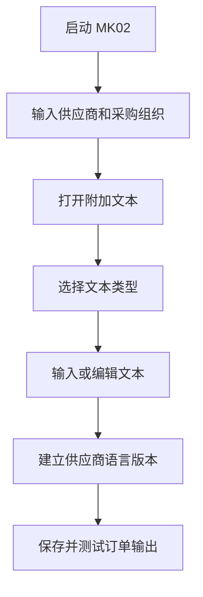

# 维护供应商采购文本及语言版本

> **用途：** 在供应商主数据中维护采购备注、交货条件等文本，并为外语供应商创建对应语言版本。  
> **Transaction Code：** `MK02`  
> **来源文件：** `Lieferant anlegen in Werk xk01.docx`  
> **状态：** 历史资料整理；字段、组织值、权限和默认布局必须在当前系统验证。

## 1. 适用范围与权限

- 适用于列表报表、供应商主数据或工厂级合同维护。
- 主数据、合同价格、合同监控和默认布局设置均可能影响其他用户或后续采购，应按权限操作。
- 示例公司、人员、供应商、材料、合同号和组织编号不写入匿名化流程。

## 2. 流程图

## 3. 页面与字段

| 页面/区域 | 字段或控件 | 填写/选择 | 说明与风险 |
|---|---|---|---|
| MK02 Einstieg | Kreditor | 供应商号 | 确认正确主记录 |
| MK02 Einstieg | Einkaufsorganisation | 目标采购组织 | 文本可受组织层级影响 |
| Menü > Zusätze | Texte | 选择 | 打开供应商文本 |
| Zentrale Texte | Sprachvorschlag | DE / EN / 供应商语言 | 必须与订单输出语言一致 |
| Zentrale Texte | Buchhaltungsnotiz | 内部财务备注 | 不要输出给供应商 |
| Zentrale Texte | Einkaufsnotiz | 采购备注 | 确认是否仅内部使用 |
| Zentrale Texte | Lieferbedingung | 交货条件文本 | 可能进入采购凭证 |
| Textzeile | 双击 | 放大编辑模式 | 适合长文本 |
| Text Toolbar | Kopieren / Löschen | 复制/删除 | 删除前需确认使用范围 |

## 4. 详细操作

1. **入口**  
   输入 `MK02`，填写供应商号与采购组织。
2. **文本菜单**  
   选择 Menü > Zusätze > Texte。
3. **文本类型**  
   根据用途选择 Buchhaltungsnotiz、Einkaufsnotiz、Lieferbedingung 或当前定义的文本类型。
4. **语言**  
   为供应商实际沟通语言创建对应 Sprachenschlüssel。英文供应商必须有 `EN` 文本，否则该文本可能不被订单输出使用。
5. **编辑**  
   双击文本行进入扩大编辑模式，输入批准内容。
6. **复制/删除**  
   利用右下方工具复制语言版本或删除错误文本；删除前确认没有依赖。
7. **保存**  
   保存供应商主数据。
8. **验证**  
   创建测试订单，确认仅应输出的文本出现，内部备注未泄露给供应商。

## 5. 完成检查

- [ ] 供应商和采购组织正确
- [ ] 文本类型正确
- [ ] 语言键与供应商语言一致
- [ ] 外部文本不含内部敏感信息
- [ ] 内部备注未进入订单输出
- [ ] 测试输出通过

## 6. 待确认事项

- ⚠️ 文本继承和输出规则由采购凭证定制决定，必须用测试订单验证。

## 7. 常见风险

- 用户默认布局和全局布局必须区分，避免覆盖其他人员的报表显示。
- 供应商扩展时不得创建重复主记录；财务、采购和语言相关文本应分别复核。
- 合同只有完成审批后才能作为有效供应源进入货源清单或 MRP 自动分配。
