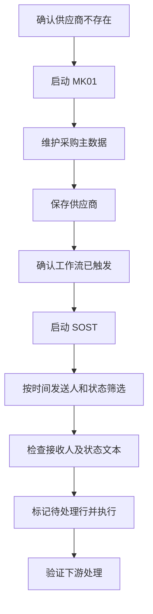

# 创建供应商并监控主数据工作流

> **用途：** 创建供应商主记录后，检查由保存动作触发的工作流或发送请求，并在需要时手工执行待处理消息。  
> **Transaction Code：** `MK01`, `SOST`  
> **来源文件：** `Workflow Lieferantenstammanlage.docx`  
> **状态：** 历史资料整理；自定义事务、工作流、阈值、数据源和更新字段必须在当前系统验证。

## 1. 适用范围与权限

- 适用于供应商主数据工作流或物料消耗稳定性分析。
- 生产主数据更新、阈值定制和消息重发均属高影响操作，应执行四眼复核。
- 示例公司、品牌、人员、邮箱、供应商、材料、地点和组织编号不写入匿名化流程。

## 2. 流程图

## 3. 页面与字段

| 页面/区域 | 字段或控件 | 填写/选择 | 说明与风险 |
|---|---|---|---|
| MK01 Einstieg | Lieferant / Einkaufsorganisation / Kontengruppe | 按当前主数据规则 | 先完成查重 |
| MK01 | Speichern | 保存 | 保存后触发主数据工作流 |
| SOST Auswahl | Sendedatum von/bis | 当前处理时段 | 缩小请求范围 |
| SOST Auswahl | Sendezeit von/bis | 按需要 | 进一步限定 |
| SOST Auswahl | Maximale Trefferzahl | 合理上限 | 避免全量结果 |
| SOST Ergebnis | Status | 等待/已发送/错误 | 查看图标和状态文本 |
| SOST Ergebnis | Dokumenttitel | 供应商创建工作流消息 | 标题应含对象但不用于唯一判断 |
| SOST Ergebnis | Sender / Empfänger | 发送人/接收人 | 匿名文档不保留历史人员和邮箱 |
| SOST Toolbar | Ausführen / Senden | 执行 | 只处理已核对的待发送行 |
| SOST Toolbar | Statustext | 查看 | 分析失败原因 |

## 4. 详细操作

1. **查重**  
   使用供应商搜索、税号、银行和地址确认不存在重复主记录。
2. **创建**  
   输入 `MK01`，按当前账户组和采购组织维护供应商采购主数据。
3. **保存**  
   保存并记录供应商号。保存动作将触发后续工作流或发送请求。
4. **打开监控**  
   输入 `SOST`，按发送日期、时间和最大结果数筛选。
5. **识别消息**  
   在结果中核对文档标题、发送人、接收人和状态。不得仅依赖标题中的供应商号。
6. **处理等待项**  
   如果当前系统仍需要人工发送，标记目标行并点击执行/发送。未来自动发送场景不得重复手工发送。
7. **错误处理**  
   对黄灯或红灯记录打开 Statustext，检查地址、通信配置、授权或技术错误。
8. **验证**  
   确认目标接收人收到工作项或消息，并检查下游主数据审批是否创建。

## 5. 完成检查

- [ ] 供应商查重完成
- [ ] MK01 保存成功
- [ ] 供应商号已记录
- [ ] SOST 筛选范围正确
- [ ] 接收人和消息对象正确
- [ ] 未重复发送
- [ ] 错误状态已处理
- [ ] 下游审批已触发

## 6. 待确认事项

- ⚠️ 源文件称未来将改为自动发送。当前系统究竟手工还是自动，必须实机确认。
- ⚠️ SOST 通常监控 SAPconnect 发送请求，不等同于业务工作流收件箱；实际架构需确认。

## 7. 常见风险

- 消息监控显示“已发送”不等于业务处理已完成，仍需检查接收方或下游工作流。
- XYZ 阈值不合理会造成整批材料错误分类，并影响 MRP 参数决策。
- 不得在未完成 Testlauf 的情况下批量更新材料主数据。
