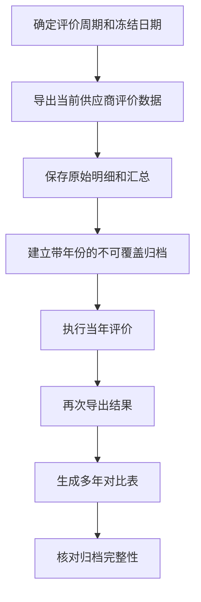

# 年度供应商评价与历史数据归档

> **用途：** 在执行年度供应商评价前导出并归档历史数据，避免系统重新评价后丢失多年趋势。  
> **Transaction Code：**   
> **来源文件：** `Lieferantenbewertung.docx`  
> **状态：** 历史资料整理；字段、组织值、库存类型、消息输出和质量工作流必须在当前系统验证。

## 1. 适用范围与权限

- 适用于发运、供应商质量、采购退货或供应商绩效管理。
- 库存过账、退货订单、质量措施关闭及供应商评价历史归档均应执行四眼复核。
- 示例公司、人员、供应商、材料、订单和地点编号不写入匿名化流程。

## 2. 流程图

## 3. 页面与字段

| 页面/区域 | 字段或控件 | 填写/选择 | 说明与风险 |
|---|---|---|---|
| 供应商评价结果 | 评价期间 | 上一完整年度或批准周期 | 一年一次的历史流程 |
| 导出 | 格式 | XLSX/CSV/PDF | 至少保留可分析数据和不可修改快照 |
| 归档命名 | 供应商号_评价年度_导出日期 | 匿名 Repository 不存真实号 | 实际业务归档需可追踪 |
| 归档元数据 | 评价模型/权重/阈值 | 同时保存 | 否则年度分数不可比 |
| 多年趋势表 | 质量/交期/服务/价格等维度 | 按当前评价模型 | 不得把模型变化误判为绩效变化 |

## 4. 详细操作

1. **计划**  
   确定年度评价时间、数据截止日、供应商范围和负责人。
2. **评价前导出**  
   在运行新评价前，导出当前系统保存的供应商评价明细与总分。
3. **双格式归档**  
   保存 XLSX/CSV 用于趋势分析，同时保存 PDF 或受控快照用于审计。
4. **元数据**  
   记录评价模型、权重、评分区间、数据范围、币种和异常处理规则。
5. **执行评价**  
   按当前批准流程运行当年供应商评价。
6. **评价后导出**  
   导出新年度结果并存入相同供应商归档目录。
7. **趋势分析**  
   维护跨年度对比，至少按质量、交期、服务和成本/价格维度；如模型变化，应分段比较。
8. **完整性检查**  
   抽查供应商总分与明细、归档日期和文件权限，确保旧数据没有被覆盖。

## 5. 完成检查

- [ ] 评价前历史数据已导出
- [ ] XLSX/CSV 与 PDF 快照齐全
- [ ] 评价模型和权重已记录
- [ ] 当年结果已导出
- [ ] 多年趋势可追踪
- [ ] 文件权限与保留期符合政策

## 6. 待确认事项

- ⚠️ 源文件未提供具体事务码或评价程序，本文不猜测。
- ⚠️ 历史资料指出系统重新评价后无法直接生成多年趋势，当前系统能力仍需验证。

## 7. 常见风险

- 不得把历史组织值、库存地点、税码或消息类型直接用于当前业务。
- 退货引用原始采购订单的设置会影响开放数量、收货和会计，必须按流程明确决定。
- 供应商评价若覆盖历史数据，必须先完成外部归档。
