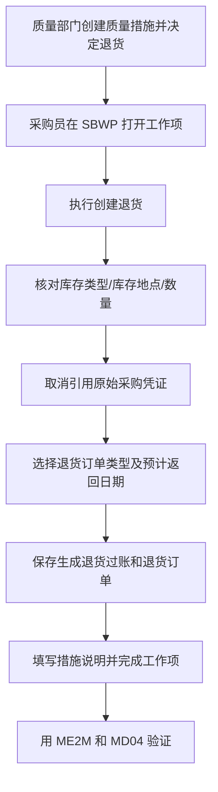

# 从质量工作项创建供应商退货

> **用途：** 根据质量部门的退货决定，从工作流措施创建退货过账和退货采购订单，并关闭质量措施。  
> **Transaction Code：** `SBWP`, `ME2M`, `MD04`  
> **来源文件：** `Lieferantenretoure anlegen.docx`  
> **状态：** 历史资料整理；字段、组织值、库存类型、消息输出和质量工作流必须在当前系统验证。

## 1. 适用范围与权限

- 适用于发运、供应商质量、采购退货或供应商绩效管理。
- 库存过账、退货订单、质量措施关闭及供应商评价历史归档均应执行四眼复核。
- 示例公司、人员、供应商、材料、订单和地点编号不写入匿名化流程。

## 2. 流程图

## 3. 页面与字段

| 页面/区域 | 字段或控件 | 填写/选择 | 说明与风险 |
|---|---|---|---|
| SBWP Eingang | Qualitätsmeldung / Workitem | 打开 | 直接进入待处理措施 |
| Maßnahmenliste | Rücklieferung anlegen 卡车图标 | 点击 | 启动退货创建 |
| Rücklieferung anlegen | Werk zum Material | 实际工厂 | 系统可能从质量批次带出 |
| Rücklieferung anlegen | Bestandsart | S | 历史流程要求保持锁定库存，不得更改 |
| Rücklieferung anlegen | Lagerort | 批准的退货库存地点 | 历史值不保留 |
| Rücklieferung anlegen | Rückzulief. Menge | 退货数量 | 应从质量检验记录带出并复核 |
| Referenz zum Einkaufsbeleg | Rücklieferung mit Bezug z. Originalbeleg | 按历史流程取消勾选 | 否则原采购订单可能重新开放 |
| Folgemaske | Bestellart | ZRET 或当前退货类型 | 必须从 NB 改为退货类型 |
| Folgemaske | Lieferdatum | 返修品或替代品预计返回日期 | 若仅要求贷项，按当前流程处理 |
| Folgemaske | Steuerkennzeichen | 当前税码 | 历史值不保留 |
| Folgemaske | Versandstelle | 退货发运点 | 按当前组织配置 |
| Maßnahme | Maßnahmentext | 退货已创建及凭证号 | 完成前记录结果 |
| Maßnahme | Zielflagge / Workitem beenden | 完成 | 归档质量措施 |
| ME2M | Material / Belegart | 退货材料/退货订单类型 | 查询最新退货订单 |
| MD04 | Material / Werk | 材料/工厂 | 验证退回与补货需求 |

## 4. 详细操作

1. **工作项**  
   在 `SBWP` 打开收件箱，选择质量通知工作项并双击进入具体措施。
2. **创建退货**  
   点击 Rücklieferung anlegen。
3. **库存数据**  
   复核工厂、库存地点和退货数量。历史流程要求 Bestandsart 保持 `S`，表示从锁定库存扣减。
4. **原单引用**  
   按历史流程取消“Rücklieferung mit Bezug z. Originalbeleg”，避免原采购订单重新开放并影响收货与会计。该决定必须按当前系统验证。
5. **退货订单**  
   把 Bestellart 从普通订单改为当前退货类型，历史示例为 `ZRET`；维护预计返修/替代品返回日期、税码和发运点。
6. **确认创建**  
   确认对话并记录系统生成的退货过账号及退货采购订单号。
7. **措施完成**  
   返回质量措施，填写结果说明，点击目标旗帜完成措施并保存。不要只结束 Workitem 而不关闭措施。
8. **订单查询**  
   用 `ME2M` 按材料和退货订单类型查找最新退货订单。
9. **需求验证**  
   用 `MD04` 检查退回数量和预期补货数量是否正确反映。

## 5. 完成检查

- [ ] 质量部门已批准退货
- [ ] 工厂/库存地点/数量正确
- [ ] 库存类型未误改
- [ ] 原采购凭证引用设置有明确依据
- [ ] 退货订单类型正确
- [ ] 退货过账号和订单号已记录
- [ ] 质量措施已完成并保存
- [ ] ME2M/MD04 验证通过

## 6. 待确认事项

- ⚠️ 是否取消原采购凭证引用必须在当前系统测试，错误设置会影响开放订单和会计。
- ⚠️ Bestandsart S、ZRET、税码和发运点均为历史设计，必须验证。

## 7. 常见风险

- 不得把历史组织值、库存地点、税码或消息类型直接用于当前业务。
- 退货引用原始采购订单的设置会影响开放数量、收货和会计，必须按流程明确决定。
- 供应商评价若覆盖历史数据，必须先完成外部归档。
