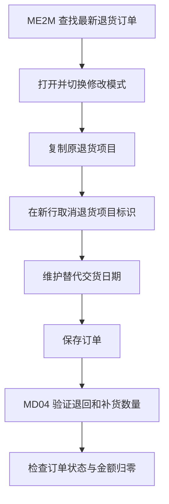

# 在退货订单中增加替代交货项目

> **用途：** 当供应商不提供贷项而是补发新品或返修品时，在退货订单中复制项目并取消新行的退货标识，形成数量对冲。  
> **Transaction Code：** `ME2M`, `ME22N`, `MD04`  
> **来源文件：** `Lieferantenretoure anlegen.docx`  
> **状态：** 历史资料整理；字段、组织值、库存类型、消息输出和质量工作流必须在当前系统验证。

## 1. 适用范围与权限

- 适用于发运、供应商质量、采购退货或供应商绩效管理。
- 库存过账、退货订单、质量措施关闭及供应商评价历史归档均应执行四眼复核。
- 示例公司、人员、供应商、材料、订单和地点编号不写入匿名化流程。

## 2. 流程图

## 3. 页面与字段

| 页面/区域 | 字段或控件 | 填写/选择 | 说明与风险 |
|---|---|---|---|
| ME2M Auswahl | Material | 受影响材料 | 限定查询 |
| ME2M Auswahl | Belegart | ZRET 或当前退货类型 | 只看退货订单 |
| ME2M Ergebnis | Belegdatum | 按日期识别最新订单 | 同时核对供应商和数量 |
| ME22N | Bearbeitungsmodus | 眼镜和铅笔 | 切换修改 |
| Positionsübersicht | Position duplizieren | 复制原退货行 | 形成负退货与正补货 |
| Neue Position | Retourenposition | 取消勾选 | 表示该行期望供应商交货 |
| Neue Position | Bestellmenge | 与退货数量匹配 | 形成数量对冲 |
| Neue Position | Lieferdatum | 预计补货或返修返回日 | 需供应商确认 |
| MD04 | BS-Ret / BS-Ein 等计划元素 | 检查 | 应同时显示退回和补货 |
| Bestellung > Status | bestellt / geliefert / noch zu liefern / berechnet | 检查数量与金额 | 目标为业务上对冲 |

## 4. 详细操作

1. **查询**  
   输入 `ME2M`，按材料及退货订单类型筛选，按凭证日期识别最新退货订单。
2. **打开**  
   双击退货订单或使用显示图标打开，然后切换到修改模式。
3. **复制**  
   标记原退货项目并复制为新行。
4. **取消退货标识**  
   在新行向右滚动找到 Retourenposition，取消勾选。系统据此把新行解释为供应商应交回的货物。
5. **数量日期**  
   新行数量通常与退货数量一致；维护供应商确认的补货或返修返回日期。
6. **保存**  
   保存订单并记录变更。
7. **MD04 验证**  
   用 `MD04` 检查同一材料既有退回数量，又有退货订单中的补货数量，避免净需求错误。
8. **状态检查**  
   检查订单抬头状态。经过补货后，订单数量和金额应按业务设计实现对冲。

## 5. 完成检查

- [ ] 选中的是最新正确退货订单
- [ ] 复制行数量正确
- [ ] 新行 Retourenposition 已取消
- [ ] 补货日期有供应商确认
- [ ] 订单已保存
- [ ] MD04 数量对冲正确
- [ ] 订单状态和金额合理

## 6. 待确认事项

- ⚠️ 源文件使用复制负数量和正数量实现对冲；当前系统的价格、税和贷项逻辑必须由采购与财务共同验证。

## 7. 常见风险

- 不得把历史组织值、库存地点、税码或消息类型直接用于当前业务。
- 退货引用原始采购订单的设置会影响开放数量、收货和会计，必须按流程明确决定。
- 供应商评价若覆盖历史数据，必须先完成外部归档。
