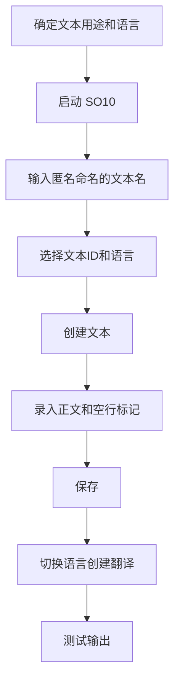

# 创建及维护多语言标准文本

> **用途：** 为采购订单、询价、合同或其他输出凭证建立可重复使用的 SAPscript 标准文本。  
> **Transaction Code：** `SO10`  
> **来源文件：** `Textbausteine (Inventur) in Bestellungen etc.docx`  
> **状态：** 历史资料整理；字段、状态、命名规则与工作流必须在当前系统验证。

## 1. 适用范围与权限

- 适用于标准文本、工程变更工作流或采购凭证查询。
- 多语言文本、工程变更状态和跨部门工作流均可能影响外部输出或主数据放行，应执行四眼复核。
- 示例公司、人员、地点、材料、凭证和组织编号不写入匿名化流程。

## 2. 流程图

## 3. 页面与字段

| 页面/区域 | 字段或控件 | 填写/选择 | 说明与风险 |
|---|---|---|---|
| SO10 Einstieg | Textname | 内部批准的中性命名 | 不得含公司名、人名或供应商名 |
| SO10 Einstieg | Text-ID | ST | 历史资料中 ST=一般标准文本 |
| SO10 Einstieg | Sprache | DE / EN / 其他目标语言 | 每种语言单独维护 |
| SO10 Einstieg | Anlegen / Ändern / Anzeigen | 创建/修改/显示 | 按任务选择 |
| Texteditor | Zeilentext | 外部可见正文 | 避免内部敏感信息 |
| Texteditor | * | 空白行标记 | 历史编辑器用星号表示文档空行 |
| Texteditor | Speichern | 保存 | 每个语言版本分别保存 |

## 4. 详细操作

1. **用途确认**  
   确定文本用于订单、询价、合同、库存盘点通知或其他文档，并确认哪些语言必须输出。
2. **命名**  
   为 Textname 使用中性、可搜索的前缀和主题，例如 `Z_TXT_<THEMA>`。不沿用历史公司专用前缀。
3. **入口**  
   输入 `SO10`，填写 Textname、Text-ID `ST` 和语言。
4. **创建**  
   点击 Anlegen，进入文本编辑器。
5. **正文**  
   录入批准文本。旧式编辑器中需要空白行时，用 `*` 建立空行。
6. **保存**  
   保存后返回。
7. **多语言**  
   切换语言代码，例如 `EN`，为同一 Textname 建立对应翻译。没有目标语言版本时，相关文本可能不打印。
8. **验证**  
   在测试采购订单、询价或合同中插入文本并预览输出，检查语言、换行和外部措辞。

## 5. 完成检查

- [ ] 文本名不含敏感实体
- [ ] Text-ID 正确
- [ ] 德语版本已复核
- [ ] 所需外语版本已维护
- [ ] 空行和格式正确
- [ ] 保存成功
- [ ] 测试输出正确

## 6. 待确认事项

- ⚠️ Text-ID ST 和星号空行是历史 SAPscript 行为，当前编辑器需验证。

## 7. 常见风险

- 标准文本缺少目标语言时，输出凭证可能完全不打印该文本。
- 工程变更状态跳转可能绕过部门维护和验证，不得无审批跳过。
- 查询结果取决于筛选条件、组织范围和布局，必须抽查凭证明细。
