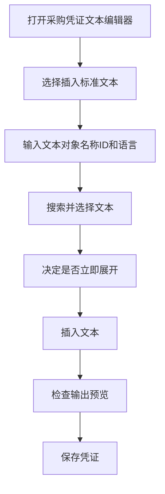

# 在采购凭证中插入标准文本

> **用途：** 将 SO10 标准文本手工插入采购订单、询价或合同的抬头/项目文本，并确保进入外部输出。  
> **Transaction Code：** `ME21N`, `ME22N`, `ME31K`, `ME41`  
> **来源文件：** `Textbausteine (Inventur) in Bestellungen etc.docx`  
> **状态：** 历史资料整理；字段、状态、命名规则与工作流必须在当前系统验证。

## 1. 适用范围与权限

- 适用于标准文本、工程变更工作流或采购凭证查询。
- 多语言文本、工程变更状态和跨部门工作流均可能影响外部输出或主数据放行，应执行四眼复核。
- 示例公司、人员、地点、材料、凭证和组织编号不写入匿名化流程。

## 2. 流程图

## 3. 页面与字段

| 页面/区域 | 字段或控件 | 填写/选择 | 说明与风险 |
|---|---|---|---|
| 采购凭证文本编辑器 | Menü > Einbinden > Text > Standard | 选择 | 打开标准文本插入窗口 |
| Text einbinden | Textobjekt | TEXT | 历史 SAPscript 文本对象 |
| Text einbinden | Textname | 标准文本名称 | 必须是 SO10 已维护文本 |
| Text einbinden | Text-ID | ST | 一般标准文本 |
| Text einbinden | Sprache | 凭证/供应商语言 | 必须有对应语言版本 |
| Text einbinden | sofort auflösen | 按需要勾选 | 立即复制正文与动态引用的差异需测试 |
| Datenbankselektion | Name von/bis | 搜索范围 | 可按前缀搜索 |
| Datenbankselektion | Maximale Trefferzahl | 适当数量 | 避免返回过多文本 |

## 4. 详细操作

1. **打开凭证**  
   在 `ME21N/ME22N` 订单、`ME41` 询价或 `ME31K` 合同中进入应输出的抬头或项目文本编辑器。
2. **插入入口**  
   选择 Menü > Einbinden > Text > Standard。
3. **文本键**  
   维护 Textobjekt `TEXT`、Textname、Text-ID `ST` 和语言。
4. **搜索**  
   未知名称时打开搜索，按中性前缀或主题筛选。
5. **选择**  
   从结果中选择已批准的文本。
6. **展开方式**  
   根据当前系统测试决定是否勾选 `sofort auflösen`。如需保留动态引用，不能随意展开。
7. **检查**  
   插入后检查正文、语言、段落和变更权限。
8. **输出验证**  
   预览采购凭证 PDF/邮件，确认文本实际打印，且没有内部备注。
9. **保存**  
   保存凭证。

## 5. 完成检查

- [ ] 选中正确文本版本
- [ ] 语言与供应商一致
- [ ] 插入到正确抬头/项目文本类型
- [ ] 外部内容已复核
- [ ] 输出预览可见
- [ ] 凭证已保存

## 6. 待确认事项

- ⚠️ 标准文本能否自动随语言切换取决于当前文本确定与输出配置。

## 7. 常见风险

- 标准文本缺少目标语言时，输出凭证可能完全不打印该文本。
- 工程变更状态跳转可能绕过部门维护和验证，不得无审批跳过。
- 查询结果取决于筛选条件、组织范围和布局，必须抽查凭证明细。
