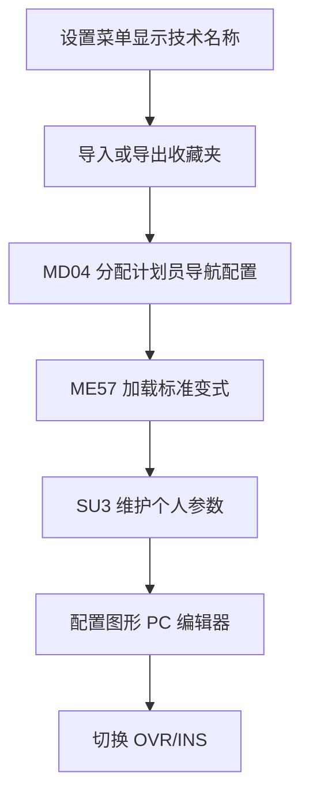

# 配置 SAP GUI 个人基本设置

> **用途：** 配置技术名称、收藏夹、MD04 导航配置、ME57 变式、个人参数、编辑器和覆盖输入模式。  
> **Transaction Code：** `SU3`, `MD04`, `ME57`  
> **来源文件：** `Grundeinstellungen Mandant in SAP.docx`  
> **状态：** 历史资料整理；字段、组织值、EDI 配置和用户参数必须在当前系统验证。

## 1. 适用范围与权限

- 适用于采购、主数据维护或个人用户设置。
- 跨公司交易、价格条件、删除标识、工作流代理和用户参数均应按权限与四眼原则处理。
- 示例编号、组织值和参数值不应直接复制到生产业务。

## 2. 流程图

## 3. 页面与字段

| 页面/区域 | 字段或控件 | 填写/选择 | 说明与风险 |
|---|---|---|---|
| SAP Easy Access > Zusätze > Einstellungen | Technische Namen anzeigen | 勾选 | 收藏夹和菜单显示事务码 |
| Favoriten | Upload von PC / Download auf PC | 导入/导出 | 导入模式：混合或挂到新文件夹 |
| MD04 > Umfeld | Navigationsprofil > Zuordnen | 选择计划员配置 | 启用相关计划导航功能 |
| ME57 | Variante holen | 选择当前标准变式 | 历史变式名称不写入流程 |
| SU3 > Parameter | Parameter-ID / Wert | 按职责维护 | 例如公司代码、采购组织、采购组、工厂、计划员 |
| SU3 > Parameter | ME_USE_GRID | X | 启用 Grid 显示的历史参数 |
| SU3 > Parameter | EVO | 当前有效值或空白 | 历史说明非空可自动把 BANF 拉入订单窗口 |
| F1 > Technische Information | Parameter-ID | 读取 | 从字段技术信息识别参数 |
| Texteditor > Springen | Editor einstellen | 选择 | 设置图形 PC 编辑器 |
| SAP GUI 状态栏 | OVR / INS | 点击切换 | INS 避免覆盖已有文本 |

## 4. 详细操作

1. **技术名称**  
   在 SAP Easy Access 选择 Zusätze > Einstellungen，勾选 Technische Namen anzeigen。
2. **收藏夹备份**  
   通过 Favoriten 菜单先下载个人收藏夹；导入时选择混合到现有结构或挂到新文件夹。
3. **MD04 配置**  
   打开任意材料的 MD04，通过 Umfeld > Navigationsprofil > Zuordnen 分配批准的计划员导航配置。
4. **ME57 变式**  
   在 ME57 打开 Variantenkatalog，选择当前采购团队批准的标准变式。
5. **个人参数**  
   用 `SU3` 的 Parameter 页签维护默认公司代码、采购组织、采购组、工厂、计划员等。
6. **查找参数 ID**  
   在目标字段按 F1，打开 Technische Information，读取 Parameter-ID 后再写入 SU3。
7. **编辑器**  
   在有文本输入的事务中打开编辑器，通过 Springen > Editor einstellen 启用 Grafischer PC-Editor。
8. **覆盖模式**  
   状态栏出现 OVR 时点击切换为 INS，防止输入文本覆盖现有内容。

## 5. 完成检查

- [ ] 技术名称已显示
- [ ] 收藏夹已备份
- [ ] MD04 导航配置正确
- [ ] ME57 使用当前标准变式
- [ ] SU3 参数与职责一致
- [ ] 编辑器可正常输入
- [ ] 状态栏为 INS

## 6. 待确认事项

- ⚠️ 历史变式名和旧导航配置名已匿名化，必须从当前团队模板选择。
- ⚠️ SU3 参数可能影响大量事务，修改后需注销重登并测试。

## 7. 常见风险

- 保存成功不代表后续接口或工作流成功，必须检查状态、消息协议或测试凭证。
- 历史默认值可能已失效，应优先使用当前模板、搜索帮助和系统配置。
