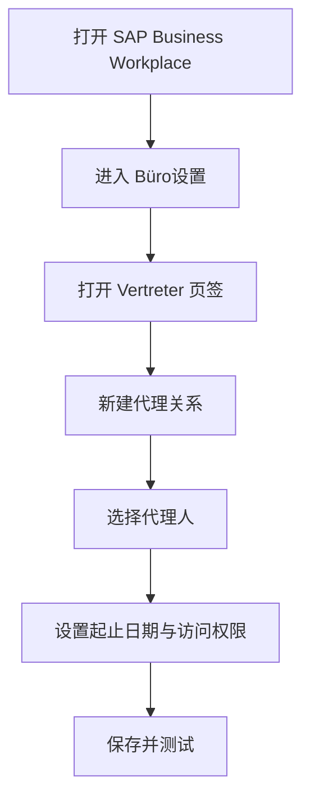

# 设置 SAP 工作流代理人

> **用途：** 在休假或缺席期间为工作流任务设置代理人、有效期和访问权限。  
> **Transaction Code：** `SBWP`  
> **来源文件：** `Grundeinstellungen Mandant in SAP.docx`  
> **状态：** 历史资料整理；字段、组织值、EDI 配置和用户参数必须在当前系统验证。

## 1. 适用范围与权限

- 适用于采购、主数据维护或个人用户设置。
- 跨公司交易、价格条件、删除标识、工作流代理和用户参数均应按权限与四眼原则处理。
- 示例编号、组织值和参数值不应直接复制到生产业务。

## 2. 流程图

## 3. 页面与字段

| 页面/区域 | 字段或控件 | 填写/选择 | 说明与风险 |
|---|---|---|---|
| SAP Easy Access | Business Workplace | 打开 | 可通过工具栏图标或 SBWP |
| Business Workplace > Einstellungen | Büroeinstellungen | 选择 | 打开个人办公室设置 |
| Büroeinstellungen | Vertreter | 页签 | 管理工作流代理 |
| Vertreter | Neu anlegen | 点击 | 创建新的代理关系 |
| Vertreter | Vertreter | 有效 SAP 用户 | 不可选离职或无权限用户 |
| Vertreter | Gültig von/bis | 代理期间 | 仅覆盖实际缺席时间 |
| Vertreter | Zugriff / Vertretungsprofil | 按角色设置 | 遵循最小权限 |

## 4. 详细操作

1. **打开**  
   进入 SAP Business Workplace，可使用 `SBWP` 或当前系统入口。
2. **设置**  
   选择 Einstellungen > Büroeinstellungen。
3. **代理页签**  
   进入 Vertreter，新增一行并点击 Neu anlegen。
4. **人员**  
   通过搜索帮助选择代理人，确认姓名对应正确 SAP 用户。
5. **期间**  
   设置开始和结束日期，避免无限期代理。
6. **权限**  
   定义访问范围和代理配置，只授予缺席期间必要的工作流任务。
7. **保存验证**  
   保存后创建或使用测试任务，验证代理人可见任务且原审批轨迹完整。
8. **结束**  
   返回后删除或停用已过期代理关系。

## 5. 完成检查

- [ ] 代理人有效且职责匹配
- [ ] 起止日期正确
- [ ] 权限符合最小权限原则
- [ ] 测试任务可见
- [ ] 审批轨迹完整
- [ ] 过期代理已计划撤销

## 6. 待确认事项

- ⚠️ 部分工作流使用 My Inbox/Fiori 代理机制，需确认是否仍通过 SBWP。

## 7. 常见风险

- 保存成功不代表后续接口或工作流成功，必须检查状态、消息协议或测试凭证。
- 历史默认值可能已失效，应优先使用当前模板、搜索帮助和系统配置。
