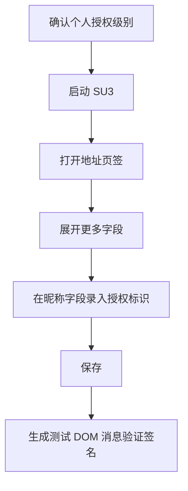

# 设置 DOM 输出签署权限标识

> **用途：** 在 DOM 邮件签名中维护合法的签署权限标识，避免未标识签名被误解为法定代表人签署。  
> **Transaction Code：** `SU3`  
> **来源文件：** `Kennzeichnung der Unterschrift einstellen.docx`  
> **状态：** 历史资料整理；字段、组织值、权限和签署规则必须在当前系统及现行制度下验证。

## 1. 适用范围与权限

- 适用于采购合同、已科目分配需求、手工采购订单或个人输出签名设置。
- 合同、财务科目分配、固定资产和签署权限均属于高影响数据，应执行四眼复核。
- 示例公司、地点、供应商、人员、编号和金额不写入匿名化流程。

## 2. 流程图

## 3. 页面与字段

| 页面/区域 | 字段或控件 | 填写/选择 | 说明与风险 |
|---|---|---|---|
| SU3 | Adresse | 页签 | 个人地址信息 |
| Adresse | Weitere Felder | 点击展开 | 显示附加字段 |
| Weitere Felder | Spitznamen | i.A. / i.V. / ppa. | 仅填写已正式授予的权限标识 |
| DOM Nachrichtenausgabe | Signatur | 授权标识位于姓名之前 | 通过测试邮件验证 |

## 4. 详细操作

1. **授权确认**  
   先向人事、法务或授权矩阵确认本人可使用的签署标识。
2. **打开设置**  
   输入 `SU3`，进入 Adresse 页签。
3. **展开字段**  
   点击 Weitere Felder。
4. **维护标识**  
   在 Spitznamen 中输入获授权的 `i.A.`、`i.V.` 或 `ppa.`。未获授权不得自行选择更高权限标识。
5. **保存**  
   保存个人主数据。
6. **验证**  
   创建测试 DOM 输出，确认签名中授权标识位于姓名之前，且不影响邮箱地址或其他个人数据。

## 5. 完成检查

- [ ] 授权标识有正式依据
- [ ] SU3 用户为本人
- [ ] Spitznamen 仅含批准标识
- [ ] 保存成功
- [ ] 测试 DOM 签名正确

## 6. 待确认事项

- ⚠️ 不同法域及公司授权规则可能不同；本文不构成法律意见。
- ⚠️ 如果 DOM 签名已由集中模板管理，Spitznamen 可能不再生效。

## 7. 常见风险

- 组织层级、科目分配或伙伴层级填写错误，会导致订单无法调用、错误记账或错误收发票地址。
- 历史示例字段可能已迁移到 BP、Fiori 或 Flexible Workflow，应以当前系统为准。
