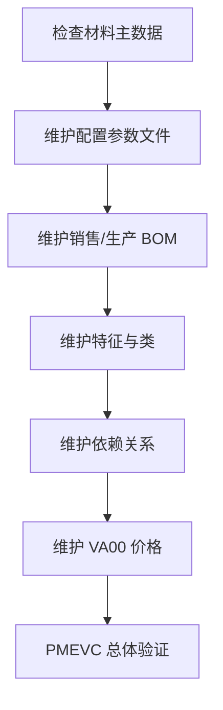

# 软管变式配置主数据

> **用途：** 维护可配置软管 A6999999 的完整 VC 模型。  
> **SAP Transaction Code：** `MM03`, `CH41`, `CH42`, `CH43`, `CS01`, `CS02`, `CS03`, `CT04`, `CU01`, `CU02`, `CU03`, `VK11`, `VK12`, `VK13`, `PMEVC`  
> **来源：** `2018_12_18_Handbuch_VC-Schlauch.docx`  
> **状态：** 从历史培训资料整理，执行前须在当前 SAP 系统验证字段、权限和组织数据。

## 1. 前置条件

- 确认材料 A6999999 与配置类 KSCHL
- 准备特征、类、依赖关系、BOM、定价条件和组织数据

## 2. 流程图

## 3. 页面与字段填写

| SAP 页面/区域 | 字段或控件 | 填写/选择 | 注意事项 |
|---|---|---|---|
| MM03 > Grunddaten 2 | Material ist konfigurierbar | 勾选 | A6999999 必须可配置 |
| CH41/42/43 > Basisdaten | Profilname / Klassenart / Status | KSCHL / 300 / 1 | 示例有效日期 01.02.2019 |
| Konfigurationseinstieg | Prozess | Plan-/Fert.Auftrag | 按现行设计复核 |
| Konfigurationseinstieg | Stücklistenauflösung | mehrstufig | 多级展开 |
| Parameter zur Stücklistenauflösung | Anwendung | PP01 | Fertigung - allgemein |
| CS01/02/03 | Verwendung | V 和 3 | V 销售 BOM，3 生产 BOM |
| CT04 | Merkmale/Objectmerkmale | 按 KSCHL 模型 | 包括重量、数量、工时、变式条件 |
| CU01/02/03 | Auswahlbedingung/Prozedur/Vorbedingung | 按命名规则 | 逻辑须先测试 |
| VK11/12/13 | Konditionsart | VA00 | 仅用 Preisliste/Variante 键组合 |
| PMEVC | Modellierungsumgebung | A6999999 | 展开完整树检查 |

## 4. 详细操作

1. **材料检查**  
   在 `MM03` 确认所有必要视图，Grunddaten 2 勾选可配置。
2. **配置参数文件**  
   用 `CH41/42/43` 维护 KSCHL、类别 300、状态、BOM 展开与界面设置。
3. **BOM**  
   维护用途 V 和 3；销售 BOM 位置用选择条件，生产 BOM 可用类位置和依赖关系。
4. **特征与类**  
   用 `CT04` 维护特征/对象特征；类别 200 用于组件选择，类别 300 KSCHL 汇总全部特征。
5. **依赖关系**  
   用 `CU01/02/03` 维护选择条件、过程与前提条件。
6. **定价**  
   用 `VK11/12/13` 维护 VA00 变式条件。
7. **总体验证**  
   在 `PMEVC` 展开模型，测试典型、边界和无效组合。

## 5. 完成检查

- [ ] A6999999 可配置标识已设置
- [ ] KSCHL 类别 300 已分配
- [ ] V/3 两套 BOM 存在
- [ ] 依赖关系无语法错误
- [ ] VA00 条件覆盖所有价格表
- [ ] PMEVC 模型测试通过

## 6. 常见风险

- 不要把“能显示”误认为“已保存”，必须确认 SAP 状态栏出现成功消息和生成的单据号。
- 如果字段与本文不一致，优先检查事务代码、凭证类型、组织层级、用户权限和 SAP 版本。
- 涉及价格、库存、会计凭证、放行或删除标识时，遵循四眼原则和公司权限矩阵。
